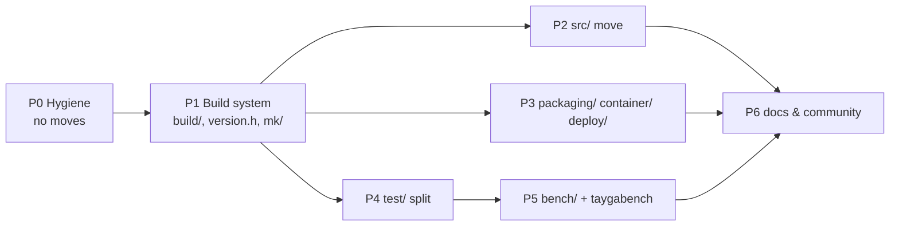

# Repository Structure Improvement Plan

> Scope: file/directory layout, build system shape, and repo hygiene of the
> `antongrizli/tayga` fork (branch `audit-compliance-fixes`, HEAD `f355a26`).
> No behavioural changes to the daemon are proposed here.
> Status: **proposal – not implemented**.

---

## 1. Current State (snapshot 2026-10-16)

```
.                          56 entries at repo root
├── *.c / *.h  (25 files)  daemon sources, flat at root (~12.5k LOC)
├── benchmark-clat.sh      80 KB / 1544 lines, root-level
├── benchmark-matrix.sh
├── Containerfile          alpine 3.20  ┐ two divergent copies of the
├── Dockerfile             alpine 3.24  ┘ same multi-stage image
├── Dockerfile.benchmark   needs the *parent* workspace as context
├── Dockerfile.test, Dockerfile.vm-bench
├── Doxyfile, LICENSE, Makefile, README.md
├── tayga.8, tayga.conf.5  generated from docs/man/*.md, but committed at root
├── tayga.conf.example
├── version.h              regenerated on every build (FORCE) yet tracked
├── release                "RELEASE=0.9.13"
├── unit_conffile.conf     test artefact
├── plan.md                65 KB audit report
├── .DS_Store              tracked in git
├── dist/                  release output (ignored)
├── perf-sessions/         56 MB benchmark results (ignored)
├── perf-comparisons/      empty timestamp dirs (NOT ignored)
├── improvenments/         (ignored)
├── src-helper/            one file: pref64-discover.c
├── docs/                  user docs + man sources + verification
├── scripts/               mix of: init/systemd units, container entrypoints,
│                          RouterOS .rsc, legacy launchers, maintainer scripts
├── test/                  C unit tests, netns integration tests, root-only
│                          system tests, tests for bench tooling, fault-injection
│                          shims, generated .log/.pcap/.rpt, repro scraps,
│                          __pycache__
└── tools/                 21 Python + 7 shell + 6 C files: benchmark studies,
                           summarizers, LD_PRELOAD shims, diagnostics, CI helper
```

### 1.1 Findings

| # | Area | Finding | Impact |
|---|------|---------|--------|
| F1 | Root | 56 root entries; sources, build products, benchmark scripts, reports and container files are mixed. | Hard to navigate; noisy `git status`; easy to ship wrong files into container context. |
| F2 | Git hygiene | `.DS_Store` is tracked. | Noise, macOS metadata leak. |
| F3 | Build | `version.h` is tracked **and** rewritten by every `make` (`.PHONY: version.h FORCE`). | Tree is dirty after each build → `git describe --dirty` always reports `-dirty`; spurious diffs/commits. |
| F4 | Build | Generated man pages (`tayga.8`, `tayga.conf.5`) live at root next to their sources in `docs/man/`. | Two sources of truth, can drift silently. |
| F5 | Build | Everything compiled in one `cc` invocation, binaries dropped into repo root; `.gitignore` enumerates every `unit_*` binary by name. | No incremental builds, no header dependency tracking, `.gitignore` drifts each time a test is added. |
| F6 | Makefile bugs | `install: $(TARGET)` (undefined); `taygabe` calls undefined `$(make-version-header)`; `VERSION_HEADER` define unused; `help` advertises `WITH_EBPF/WITH_MULTIQUEUE/WITH_SEG_OFFLOAD` which do not exist; `TEST_CFLAGS` used by only one target, `-coverage` appended twice. | Misleading, partly broken targets. |
| F7 | Containers | `Containerfile` (alpine 3.20, no `tayga-status`) and `Dockerfile` (alpine 3.24) diverged. Podman prefers `Containerfile`, so `make container` builds the **stale** one; it also uses `--target final-clat/final-nat64`, but both files name the stages `clat`/`nat64`. | `make container` is broken; CI (uses `./Dockerfile`) and local builds differ. |
| F8 | Containers | `Dockerfile.benchmark` `COPY`s from `telekom-nat64-minimal/` and `tayga-clat-perf/` – only buildable from the parent directory. | Not reproducible from a clone of this repo. |
| F9 | Scripts | `scripts/clat-start.sh` and `scripts/container/clat-start.sh` are different files with the same name. `scripts/` mixes service units, container rootfs, RouterOS scripts and maintainer tools. | Unclear which copy is authoritative; packaging targets are hard to reason about. |
| F10 | Tests | `test/` contains 5 different kinds of things (C unit, netns integration, root-only system tests, tests for benchmark tooling, LD_PRELOAD fault shims) plus generated `*.log/*.pcap/*.rpt`, `tayga.conf`, `tayga.map`, `__pycache__` and `repro/ptb/_ptb_send{,2,3}.py` iteration scraps. | No clear way to run "just the fast tests" vs "root tests"; generated files written into the source tree. |
| F11 | Tests | Integration harness hard-codes `./tayga` and `test/tayga.conf` (cwd-relative). | Blocks out-of-tree builds; fails when run from other dirs. |
| F12 | Docs | `test/index.md` references a non-existent `make fullsuite`; `index.md` is not rendered by GitHub as a directory README. | Stale contributor docs. |
| F13 | Bench | Benchmark logic is split between root (`benchmark-*.sh`), `tools/` (studies, summarizers, C shims), `tools/lima-perf/`, and tests in `test/`. 21 Python scripts with hyphenated names (not importable). | Duplicated helper code, hard to test, hard to find. |
| F14 | Artefacts | `perf-sessions/` (56 MB) and `perf-comparisons/` live in the repo root although `tools/lima-perf` already defaults to `$XDG_STATE_HOME/tayga/perf-sessions`. | Large local clutter; `perf-comparisons/` not ignored. |
| F15 | Docs | 65 KB audit `plan.md` at root (a diverged copy in ignored `improvenments/`). | Root clutter; two versions of the same report. |
| F16 | Community | No `CONTRIBUTING.md`, `SECURITY.md`, `CHANGELOG.md`, `CODEOWNERS`, `.clang-format`, `dependabot.yml`. | For a network daemon that just had CRITICAL audit findings, a security policy and changelog are expected. |
| F17 | Naming | `improvenments/` is misspelled. `release` file name is ambiguous. | Minor. |

---

## 2. Guiding Principles

1. **Keep upstream compatibility cheap.** `apalrd/tayga` (configured as `upstream`)
   is still flat-root with `test/`, `docs/`, `scripts/`, `Containerfile`.
   We keep `test/`, `docs/`, `scripts/` names, and do all moves as
   *pure-rename commits* so git rename detection keeps merges/cherry-picks working
   (see §5.3).
2. **Separate by lifecycle, not by language**: product code, packaging, deployment,
   tests, benchmarks, maintainer scripts, docs.
3. **Source tree is read-only during build/test.** All generated output goes to
   `build/` (Meson/CMake/Autotools convention, "out-of-tree build").
4. **Pitchfork-style top level** (`src/`, `test/`, `docs/`, `tools/`, …) adapted
   for a single-binary C daemon: no `include/` because there is no public API –
   headers stay next to their `.c` files.
5. **One authoritative copy** of every file (one Containerfile, one `clat-start.sh`).
6. **Results live outside the repo** (`$XDG_STATE_HOME`), only fixtures/golden data
   are committed.
7. **GitHub community-health files** at standard locations.

---

## 3. Target Layout

```
tayga/
├── README.md  LICENSE  CHANGELOG.md  CONTRIBUTING.md  SECURITY.md
├── Makefile                     thin entry point; includes mk/*.mk
├── VERSION                      replaces `release` (single line: 0.9.13)
├── .editorconfig  .clang-format  .gitignore  .dockerignore  .git-blame-ignore-revs
│
├── .github/
│   ├── workflows/               basic, tests, docker, release, review-gates
│   ├── dependabot.yml           github-actions + docker base-image digests
│   ├── CODEOWNERS
│   ├── PULL_REQUEST_TEMPLATE.md
│   └── ISSUE_TEMPLATE/
│
├── mk/                          Makefile fragments
│   ├── config.mk                CC/CFLAGS/paths/feature flags (WITH_URING …)
│   ├── tayga.mk                 daemon + helper binaries
│   ├── test.mk                  unit / integration / system / portable
│   ├── bench.mk                 LD_PRELOAD shims, bench helpers
│   ├── container.mk             podman/docker targets
│   └── install.mk
│
├── src/                         everything that ends up in the `tayga` binary
│   ├── tayga.c  tayga.h  list.h  log.c
│   ├── conffile.c  addrmap.c  dynamic.c
│   ├── nat64.c
│   ├── tun.c  tun_steering.h  netlink_io.h
│   ├── gso.c  gso.h
│   ├── experimental_io.c  experimental_io.h  flow_dispatch.h
│   ├── packet_io.h  packet_io_lifetime.h
│   ├── stats.c  stats.h  stats_exporter.c
│   ├── version.h.in             template; real version.h generated into build/
│   └── helpers/
│       └── pref64-discover.c    (was src-helper/)
│
├── tools/                       user-facing diagnostics shipped/documented
│   ├── probe-tun-offload.c
│   └── diagnose-memory.sh
│
├── packaging/                   OS integration consumed by `make install`
│   ├── systemd/tayga@.service
│   ├── openrc/tayga.initd
│   ├── openrc/tayga.confd
│   └── tayga.conf.example
│
├── container/                   single source of truth for OCI images
│   ├── Containerfile            (merged Dockerfile+Containerfile; stages build/production/clat/nat64)
│   ├── Containerfile.dockerignore   BuildKit per-file ignore (context stays repo root)
│   ├── test.Containerfile       (was Dockerfile.test)
│   └── rootfs/                  copied verbatim into the image
│       ├── usr/local/sbin/entrypoint.sh
│       ├── usr/local/sbin/clat-start.sh
│       ├── usr/local/sbin/nat64-start.sh
│       ├── usr/local/sbin/diagnose.sh
│       ├── usr/local/sbin/tayga-status
│       └── etc/unbound/unbound.conf.template
│
├── deploy/                      target-specific deployment recipes
│   ├── mikrotik/                (was scripts/mikrotik/*.rsc + README)
│   └── standalone/              legacy launch.sh / launch-clat.sh / launch-nat64.sh
│                                (or delete if superseded by container entrypoints)
│
├── bench/                       performance laboratory (not shipped)
│   ├── README.md                how to run, where results go, methodology
│   ├── clat/benchmark-clat.sh   (split into lib/*.sh over time, see §4.6)
│   ├── clat/benchmark-matrix.sh
│   ├── lima/                    (was tools/lima-perf/)
│   ├── containers/vm.Containerfile          (was Dockerfile.vm-bench)
│   ├── containers/benchmark.Containerfile   (was Dockerfile.benchmark – see F8)
│   ├── shims/                   LD_PRELOAD / helper C programs
│   │   ├── iperf-start-gate.c  udp-drain-guard.c
│   │   ├── udp-batch-endpoint.c  iperf-read-diagnostic.c
│   ├── taygabench/              importable Python package
│   │   ├── __init__.py  __main__.py   `python -m taygabench <cmd>`
│   │   ├── common.py            shared session/manifest/iperf parsing code
│   │   ├── studies/             affinity, dispatch, napi, tcp_flow, tcp_worker,
│   │   │                        tun_steering, udp_batch, udp_envelope, iperf_start,
│   │   │                        iperf_read, steering_integrity, review_baseline,
│   │   │                        controlled_ab, ablation
│   │   ├── summarize/           tcp_flow, tcp_placement, tcp_worker,
│   │   │                        tun_steering, udp_batch
│   │   ├── compare.py           (was compare-perf-sessions.py)
│   │   └── memory.py            (was sample-process-memory.py)
│   ├── scripts/                 analyze-perf-session.sh, run-*-impl-bench.sh,
│   │                            run-udp-matrix.sh, run-ablation-study.sh
│   └── tests/                   pytest tests for the bench tooling (no root needed)
│
├── test/
│   ├── README.md                (was index.md; fixed)
│   ├── unit/                    C unit tests
│   │   ├── unit.c  unit.h
│   │   └── unit_*.c  (14 files)
│   ├── fault/                   LD_PRELOAD fault-injection shims
│   │   ├── napi_ioctl_fault.c  offload_ioctl_fault.c
│   │   ├── startup_fault.c  udp_endpoint_fault.c
│   ├── integration/             netns packet tests (`make integration`)
│   │   ├── test_env.py
│   │   ├── addressing.py  mapping.py  mapfile.py
│   │   ├── translate.py  segment.py  bigendian.py
│   ├── system/                  root-only tests that start a real tayga
│   │   ├── test_auto_fallback.py  test_auto_negotiation.py  test_auto_persistent.py
│   │   ├── test_startup_rollback.py  test_worker_burst.py  test_napi_initialization.py
│   │   ├── test_udp_gso_kernel.py  test_tun_steering.py  test_tun_steering_lifecycle.py
│   │   ├── test_pmtud.py  test_pmtud_b.py  test_correctness.py
│   │   ├── test_dispatch_fragments.py  test_preflight.py
│   ├── portable/                run_portable.py + any non-root python tests
│   ├── fixtures/                committed input data (e.g. unit_conffile.conf template)
│   └── repro/ptb/               cleaned: one runner, one sender, named .bin fixtures
│
├── scripts/                     maintainer / CI scripts only
│   ├── build-arm64.sh
│   ├── update-image-tags.sh
│   └── ci/check-doc-links.py
│
├── docs/
│   ├── README.md                index
│   ├── clat/ nat64/ siit/ mapt/ container/   (unchanged user guides)
│   ├── performance/gso-gro-tuning.md          (was GSO-GRO-TUNING.md)
│   ├── man/
│   │   ├── tayga.8.md  tayga.conf.5.md        sources
│   │   └── tayga.8  tayga.conf.5              generated, committed, CI-checked
│   ├── rfc.md
│   ├── verification/
│   └── dev/                     contributor docs
│       ├── architecture.md      threads, IO paths, GSO, steering
│       ├── testing.md           unit vs integration vs system vs bench
│       ├── benchmarking.md      → links bench/README.md
│       ├── release.md
│       └── audits/2026-10-audit.md   (was root plan.md)
│
└── build/                       (gitignored) objects, binaries, coverage,
                                 generated version.h, test output, pcaps
```

Root goes from **56 → ~16** entries.

### 3.1 Why these choices

| Decision | Rationale | Alternative considered |
|----------|-----------|------------------------|
| `src/` flat, no subdirs per subsystem | 25 files / 12.5k LOC; subdirs would add `-I` noise and break `#include "tayga.h"` style used everywhere. Revisit if > ~50 files. | `src/core`, `src/io`, `src/offload` – premature. |
| No `include/` | Single executable, no installed headers/library. | Pitchfork `include/` – only useful for libraries. |
| Keep `test/` (not `tests/`) | Same name as upstream → fewer conflicts. | `tests/` (Pitchfork) – churn without benefit. |
| `packaging/` vs `container/` vs `deploy/` | Three different consumers: `make install` / OCI build / operator on a router. | Everything in `scripts/` (status quo) – ambiguous. |
| `container/rootfs/` mirror | Containerfile becomes `COPY container/rootfs/ /`; adding a script needs no Containerfile edit; paths in repo == paths in image. | Individual `COPY` lines (status quo). |
| Containerfile in `container/` + per-file `.dockerignore` | BuildKit/Buildah read `<file>.dockerignore` next to the Containerfile; context remains repo root. | Keep at root – acceptable fallback if upstream sync matters more (see §5.3). |
| `bench/` separate from `test/` and `tools/` | Benchmarks are a laboratory with their own lifecycle and dependencies (iperf3, perf, Lima). | `tools/` (status quo). |
| `taygabench` Python package | Hyphenated scripts can't be imported; tests currently need `importlib` tricks; shared code is duplicated. Package enables `pytest`, `ruff`, type-checking. | Keep scripts, add `bench/lib/`. |
| `build/` out-of-tree | Clean `git status`, one `.gitignore` line, parallel/incremental builds, sanitizer/coverage variants side by side (`BUILDDIR=build/asan`). | In-tree objects. |
| `VERSION` file | Conventional; easy to read from Make, CI, Containerfile, man footer. | `release` with `RELEASE=` prefix. |

---

## 4. Detailed Recommendations

### 4.1 Repo hygiene (no moves, do first)

- `git rm --cached .DS_Store`; add `.DS_Store` to `.gitignore`.
- Delete local `perf-sessions/` and `perf-comparisons/` (results already default to
  `$XDG_STATE_HOME/tayga/perf-sessions`); keep a single ignore rule for safety.
- Remove `Containerfile` **or** `Dockerfile` (keep the alpine 3.24 one, it is what CI
  builds), fix `make container` stage names (`--target clat` / `--target nat64`).
- Resolve the two `clat-start.sh` copies: keep `scripts/container/clat-start.sh`
  (used by the image and CI), delete or rename the other.
- Move `plan.md` → `docs/dev/audits/2026-10-audit.md`; delete the stale copy.
- Rename `improvenments/` → `improvements/` (or `docs/dev/proposals/` if they should be tracked).
- Clean `test/repro/ptb/`: keep one runner + one sender + named fixtures, drop `_send2/_send3/_debug` iterations.
- Set `PYTHONDONTWRITEBYTECODE=1` in test targets (or `-p no:cacheprovider`) to stop `__pycache__` in source dirs.

### 4.2 `.gitignore` after restructure

```gitignore
# build output
/build/
/dist/

# editor / OS
.DS_Store
.vscode/
*.swp

# python
__pycache__/
*.pyc
.pytest_cache/
.ruff_cache/

# local configs / results
/tayga.conf
/perf-sessions/
/perf-comparisons/

# docs output
/html/
/latex/
```
All per-binary lines (`unit_*`, `tools/*.so`, `*.gcda` …) disappear because they live in `build/`.

### 4.3 Build system

1. **Out-of-tree objects** with automatic header deps:
   ```make
   BUILDDIR ?= build
   OBJS := $(SOURCES:src/%.c=$(BUILDDIR)/obj/%.o)
   CPPFLAGS += -Isrc -I$(BUILDDIR)/gen -MMD -MP
   $(BUILDDIR)/obj/%.o: src/%.c | $(BUILDDIR)/obj
   	$(CC) $(CPPFLAGS) $(CFLAGS) -c -o $@ $<
   $(BUILDDIR)/tayga: $(OBJS)
   	$(CC) $(LDFLAGS) -o $@ $^ $(LDLIBS)
   -include $(OBJS:.o=.d)
   ```
   Keep a convenience `./tayga` symlink/copy for one release so existing docs keep working.
2. **Generated `version.h`** into `$(BUILDDIR)/gen/version.h`, written only if content
   changed (`cmp -s || mv`) so it does not force full rebuilds. Stop tracking `version.h`.
   Fallback order: `VERSION=` arg → `git describe` → `VERSION` file (for tarball/
   container builds without `.git`).
3. **`make release`** edits `VERSION` + `CHANGELOG.md` instead of committing `version.h`.
4. **Split Makefile** into `mk/*.mk`; root `Makefile` keeps public targets
   (`all static test integration system-test bench-tools man install clean container help`).
5. **Test object library**: build sources once into `$(BUILDDIR)/libtayga_test.a`
   and link each `unit_*` against it instead of re-listing 8 sources per target.
6. **Fix F6 bugs** (`$(TARGET)`, `make-version-header`, help text, duplicate `-coverage`).
7. **Sanitizer/coverage variants** become `make BUILDDIR=build/asan CFLAGS=...` –
   simplifies `review-gates.yml` (no `make clean` between jobs).
8. **`make check-man`**: regenerate man pages to a temp dir and `diff` against
   `docs/man/` (fails CI on drift, F4).

### 4.4 Tests

- Split by privilege/speed (see tree). Make targets:
  - `make test` → C unit tests (no root, seconds)
  - `make test-portable` → Python non-root + bench tooling tests
  - `sudo make integration` → netns packet tests
  - `sudo make system-test` → `test/system/*` (what review-gates runs today)
- Replace hard-coded `./tayga` / `test/tayga.conf` in `test_env.py` with
  `TAYGA_BIN` (default `build/tayga`) and `TAYGA_TEST_OUT` (default
  `build/test-output/<suite>`). `.log/.pcap/.rpt/tayga.conf/tayga.map` go there.
- Fault shims (`test/fault/*.c`) get Make targets in `test.mk` instead of being built ad hoc by Python.
- Rename `test/index.md` → `test/README.md`, fix `make fullsuite` reference and "Tets" typo.
- Optionally adopt `pytest` as a runner for Python suites (keeps `unittest` compatibility; gives markers `@pytest.mark.root`, `@pytest.mark.slow`, JUnit XML for CI).

> [!NOTE]
> The test classification in §3 is inferred from file names and CI usage
> (`review-gates.yml`); verify each file's privilege needs while moving.

### 4.5 Containers

- One `container/Containerfile`, stages `build` → `production` → `clat` / `nat64`.
- `COPY container/rootfs/ /` replaces six `COPY` lines.
- Build args `TAYGA_VERSION`, `TAYGA_COMMIT` (already used by CI) feed `make VERSION=… COMMIT=…`.
- `Dockerfile.benchmark` (F8): either move it to the parent `telekom-nat64-minimal`
  workspace where its context lives, or vendor the needed files into `bench/` so it
  builds from this repo alone.
- Update `.github/workflows/{docker,release}.yml` `file:` to `container/Containerfile`,
  and `scripts/build-arm64.sh` `-f`.
- Enable Dependabot `docker` ecosystem to bump the pinned alpine digests.

### 4.6 Benchmarks

- Move per §3. Shared Python code (session layout, manifest hashing, iperf JSON
  parsing, summary tables) → `taygabench/common.py`; each study becomes a module
  with a `main(argv)`; one CLI: `python -m taygabench study udp-batch …`.
- Add `bench/pyproject.toml` (no runtime deps beyond stdlib if possible; dev deps:
  `pytest`, `ruff`), so `pip install -e bench[dev]` works in a venv.
- `benchmark-clat.sh` (1544 lines): split into `bench/clat/lib/{netns,iperf,offload,collect}.sh`
  sourced by a thin entrypoint; add `shellcheck` to CI.
- Results always outside the repo: `PERF_SESSION_ROOT` default as in `tools/lima-perf`;
  apply the same default to all studies.

### 4.7 Docs & community files

- `CHANGELOG.md` (Keep a Changelog format) – release notes currently live in ignored `dist/release_notes_*.md`.
- `SECURITY.md` – reporting channel, supported versions (daemon handles untrusted packets).
- `CONTRIBUTING.md` – build, test matrix, commit convention (repo already uses Conventional Commits), upstream-sync policy.
- `.github/CODEOWNERS`, PR template with checklist (unit, integration, docs links, man regenerated).
- `.clang-format` matching current style (tabs, K&R) + optional CI check on changed lines only.
- `docs/dev/architecture.md` – extract the architecture overview from the audit report.
- Keep `tools/check-doc-links.py` → `scripts/ci/check-doc-links.py`; it will catch every broken link after moves.

---

## 5. File Move Map

### 5.1 Old → new

| Old | New |
|-----|-----|
| `*.c`, `*.h` (root, except `version.h`) | `src/` |
| `version.h` | generated `build/gen/version.h` (untracked) |
| `src-helper/pref64-discover.c` | `src/helpers/pref64-discover.c` |
| `release` | `VERSION` |
| `tayga.8`, `tayga.conf.5` | `docs/man/` |
| `tayga.conf.example` | `packaging/tayga.conf.example` |
| `scripts/tayga@.service` | `packaging/systemd/tayga@.service` |
| `scripts/tayga.initd`, `scripts/tayga.confd` | `packaging/openrc/` |
| `Dockerfile` (+ delete `Containerfile`) | `container/Containerfile` |
| `.dockerignore` | `container/Containerfile.dockerignore` (keep root copy for docker<23) |
| `Dockerfile.test` | `container/test.Containerfile` |
| `Dockerfile.vm-bench` | `bench/containers/vm.Containerfile` |
| `Dockerfile.benchmark` | parent repo **or** `bench/containers/benchmark.Containerfile` |
| `scripts/container/*.sh` | `container/rootfs/usr/local/sbin/` |
| `scripts/container/config/unbound.conf.template` | `container/rootfs/etc/unbound/` |
| `scripts/clat-start.sh` | delete (superseded) – confirm first |
| `scripts/launch*.sh` | `deploy/standalone/` or delete |
| `scripts/mikrotik/` | `deploy/mikrotik/` |
| `benchmark-clat.sh`, `benchmark-matrix.sh` | `bench/clat/` |
| `tools/lima-perf/` | `bench/lima/` |
| `tools/run-*.py`, `tools/run_controlled_ab.py` | `bench/taygabench/studies/` |
| `tools/summarize-*.py` | `bench/taygabench/summarize/` |
| `tools/compare-perf-sessions.py` | `bench/taygabench/compare.py` |
| `tools/sample-process-memory.py` | `bench/taygabench/memory.py` |
| `tools/{iperf-start-gate,udp-drain-guard,udp-batch-endpoint,iperf-read-diagnostic}.c` | `bench/shims/` |
| `tools/*.sh` (bench) | `bench/scripts/` |
| `tools/check-doc-links.py` | `scripts/ci/check-doc-links.py` |
| `tools/probe-tun-offload.c`, `tools/diagnose-memory.sh` | stay in `tools/` |
| `test/unit*.c`, `test/unit.h` | `test/unit/` |
| `test/*_fault.c` | `test/fault/` |
| `test/{addressing,mapping,mapfile,translate,segment,bigendian,test_env}.py` | `test/integration/` |
| `test/test_{benchmark_*,*_study,compare_perf_sessions,iperf_*,udp_batch_*,udp_common_stop,udp_drain_guard,lima_retention}.py` | `bench/tests/` |
| remaining `test/test_*.py` | `test/system/` |
| `test/run_portable.py` | `test/portable/` |
| `test/index.md` | `test/README.md` |
| `docs/GSO-GRO-TUNING.md` | `docs/performance/gso-gro-tuning.md` |
| `plan.md` | `docs/dev/audits/2026-10-audit.md` |

### 5.2 References that must be updated

- `Makefile` (all source/test paths, install paths, container targets).
- `.github/workflows/*.yml`: `basic`, `tests` (`make integration`), `docker`/`release`
  (`file: ./Dockerfile`, `scripts/update-image-tags.sh`), `review-gates`
  (`test/test_*.py`, `scripts/container/clat-start.sh`, `make test-portable check-docs`).
- `scripts/build-arm64.sh` (`-f Dockerfile`).
- Python `ROOT = Path(__file__).resolve().parents[1]` (≈8 files) → depth changes; replace with a helper that walks up to the dir containing `Makefile`.
- `tools/lima-perf/*.sh` (`$SCRIPT_DIR/../compare-perf-sessions.py`, rsync excludes).
- `README.md`, `docs/**`, `test/README.md` links (validated by `check-docs`).
- Container image paths are **unchanged** (`/usr/local/sbin/...`), so RouterOS scripts and deployed users are unaffected.

### 5.3 Keeping upstream merges working

- Do each move as a **rename-only commit** (no content edits) and a separate
  follow-up commit for path fixes → 100 % similarity, git rename detection is reliable.
- Set `git config merge.renameLimit 2000` and `diff.renames true` locally/CI.
- Applying upstream patches that still touch root paths:
  `git format-patch -1 <sha> --stdout | git am -3 --directory=src` for source-only
  patches; `git cherry-pick -X find-renames` otherwise.
- Add the rename commits to `.git-blame-ignore-revs` (GitHub honours it) and
  `git config blame.ignoreRevsFile .git-blame-ignore-revs`.
- If upstream sync frequency is high, a **lighter variant** is valid: do §4.1–4.3,
  §4.5–4.7 and the `bench/` + `packaging/` + `test/` moves, but leave C sources at root.
  This captures ~70 % of the benefit with near-zero merge cost.

---

## 6. Migration Plan



| Phase | Content | Effort | Risk | Done when |
|-------|---------|--------|------|-----------|
| P0 | §4.1, Makefile bug fixes (F6), fix `make container` (F7) | S | Low | CI green; `git status` clean after `make && make test` |
| P1 | §4.3 out-of-tree build, generated version.h, `mk/` split, test lib | M | Med | Same binary behaviour (`tayga --version`, `make install DESTDIR=/tmp/a` file list unchanged except paths noted) |
| P2 | `git mv *.c *.h src/` (rename-only) + path fix commit | S | Med (upstream) | CI green on Linux/FreeBSD/static Alpine |
| P3 | packaging/, container/ (merged, rootfs), deploy/ | M | Med | Image digest contents identical (`container-diff`/`dive`), `make install WITH_SYSTEMD=1 WITH_OPENRC=1` OK |
| P4 | test/ split, `TAYGA_BIN`/`TAYGA_TEST_OUT`, new make targets | M | Med | `make test`, `make test-portable`, `sudo make integration`, `sudo make system-test` all green; no files written under `test/` |
| P5 | bench/ move, Python package, shellcheck, script split | L | Low (not shipped) | `bench/tests` green; one Lima session reproduces previous numbers within noise |
| P6 | CHANGELOG, SECURITY, CONTRIBUTING, CODEOWNERS, dependabot, docs/dev | S | Low | `make check-docs` green |

### 6.1 Verification checklist per phase

- [ ] `make clean && make && make test` (gcc + clang, with/without LTO)
- [ ] `gmake` on FreeBSD job
- [ ] `make static` in Alpine (release path)
- [ ] `sudo make integration`
- [ ] review-gates (ASan/UBSan/TSan, io_uring, system tests)
- [ ] `make check-docs` (link checker)
- [ ] Container build for `clat` and `nat64` targets + smoke test (`MODE=diagnose`)
- [ ] `make install DESTDIR=$(mktemp -d)` tree compared to pre-change baseline
- [ ] `git status --porcelain` empty after full build + test run

---

## 7. References

- Pitchfork layout (C/C++ project conventions) – <https://github.com/vector-of-bool/pitchfork>
- GNU Coding Standards, Makefile conventions – <https://www.gnu.org/prep/standards/html_node/Makefile-Conventions.html>
- Paul D. Smith, "Auto-Dependency Generation" (`-MMD -MP`) – <https://make.mad-scientist.net/papers/advanced-auto-dependency-generation/>
- Docker/BuildKit per-Dockerfile ignore files – <https://docs.docker.com/build/concepts/context/#filename-and-location>
- GitHub community health files – <https://docs.github.com/en/communities/setting-up-your-project-for-healthy-contributions>
- `.git-blame-ignore-revs` – <https://docs.github.com/en/repositories/working-with-files/using-files/viewing-and-understanding-files#ignore-commits-in-the-blame-view>
- Keep a Changelog – <https://keepachangelog.com/>
- Python packaging (`pyproject.toml`) – <https://packaging.python.org/en/latest/guides/writing-pyproject-toml/>
- XDG Base Directory spec (results outside repo) – <https://specifications.freedesktop.org/basedir-spec/latest/>
