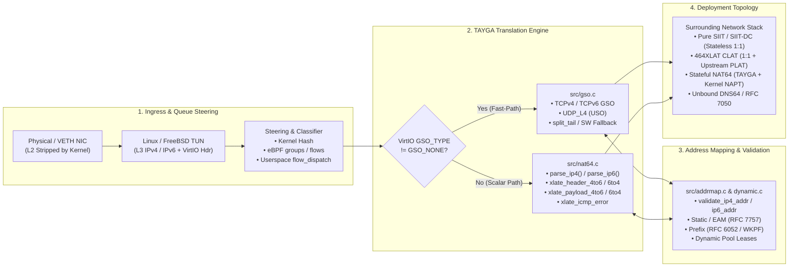

# Comprehensive Network Protocols Compatibility & Testing Guide for TAYGA (`tayga-clat-perf`)

**Date:** 2026-10-17  
**Project:** `tayga-clat-perf` (High-Performance Stateless NAT64 / SIIT / 464XLAT CLAT for Linux, FreeBSD & MikroTik RouterOS)  
**Primary Codebase References:**
- Core Translator & ICMP Engine: [`src/nat64.c`](../src/nat64.c), [`src/tayga.h`](../src/tayga.h)
- VirtIO GSO / GRO / USO & Checksum Offload Engine: [`src/gso.c`](../src/gso.c), [`src/gso.h`](../src/gso.h)
- Address Mapping, RFC 6052 & RFC 7757 EAM: [`src/addrmap.c`](../src/addrmap.c), [`src/dynamic.c`](../src/dynamic.c), [`src/conffile.c`](../src/conffile.c)
- Multiqueue TUN, eBPF Steering & Flow Dispatch: [`src/tun.c`](../src/tun.c), [`src/tun_steering.h`](../src/tun_steering.h), [`src/flow_dispatch.h`](../src/flow_dispatch.h), [`src/experimental_io.c`](../src/experimental_io.c)
- RFC 7050 DNS64 Prefix Discovery Helper: [`src/helpers/pref64-discover.c`](../src/helpers/pref64-discover.c)
- Container & RouterOS Runtime: [`container/rootfs/usr/local/sbin/clat-start.sh`](../container/rootfs/usr/local/sbin/clat-start.sh), [`container/rootfs/usr/local/sbin/nat64-start.sh`](../container/rootfs/usr/local/sbin/nat64-start.sh), [`deploy/mikrotik/`](../deploy/mikrotik/)
- Verification & Test Suites: [`test/integration/translate.py`](../test/integration/translate.py), [`test/integration/addressing.py`](../test/integration/addressing.py), [`test/integration/mapping.py`](../test/integration/mapping.py), [`test/integration/segment.py`](../test/integration/segment.py), [`test/system/`](../test/system/), [`test/unit/`](../test/unit/)

---

## 1. Executive Summary & Architectural Overview

TAYGA is an out-of-kernel **Stateless IP/ICMP Translator (SIIT)** implementing **RFC 7915**, **RFC 6052**, **RFC 7757**, **RFC 6791**, **RFC 6864**, and **RFC 8215**, enhanced in `tayga-clat-perf` with Linux VirtIO Generic Segmentation Offload (**GSO**), UDP Segmentation Offload (**USO**), partial checksum offload (`VIRTIO_NET_HDR_F_NEEDS_CSUM`), multiqueue **eBPF flow steering** (`--tun-steering=groups|flows`), and **RFC 7050** automated DNS64 prefix discovery.

Because TAYGA operates as a **stateless Layer 3 / Layer 4 header translator** over a kernel `TUN` interface (`IFF_TUN | IFF_NO_PI`), whether a given network protocol works through this project depends on **four distinct architectural layers**:



### Key Architectural Rules Governing Protocol Compatibility

1. **Pure Layer 3 Operation (`src/tun.c`, `src/tayga.h`)**:
   TAYGA attaches to `IFF_TUN` devices without Ethernet framing. Layer 2 protocols (ARP, NDP, 802.1Q VLAN tags, PPPoE headers, LLDP, STP) are terminated by the host OS kernel before packets enter `tun_fd`.
2. **Unicast-Only Enforcement (`src/addrmap.c:validate_ip4_addr`, `validate_ip6_addr`)**:
   TAYGA strictly rejects IPv4 multicast (`224.0.0.0/4`), IPv4 limited broadcast (`255.255.255.255`), IPv4 loopback (`127.0.0.0/8`), IPv4 `0.0.0.0/8`, IPv4 link-local (`169.254.0.0/16` -> `ERROR_LOCAL`), IPv6 unspecified/loopback (`0000::/8`), IPv6 multicast (`ff00::/8`), and IPv6 link-local (`fe80::/10`). Any protocol relying on multicast or link-local addressing cannot traverse TAYGA directly.
3. **Transport Layer Dispatch (`src/nat64.c:xlate_payload_4to6`, `xlate_payload_6to4`)**:
   TAYGA inspects the upper-layer protocol number (`p->data_proto`) after stripping IPv4 options or IPv6 extension headers (`Hop-by-Hop 0`, `Routing 43`, `Fragment 44`, `Destination Options 60`):
   - **ICMPv4 (`1`) <-> ICMPv6 (`58`)**: Full RFC 7915 stateful-free message, type/code, pointer, MTU, and inner-packet translation.
   - **TCP (`6`)**: Full incremental pseudo-header checksum update (RFC 1624), VirtIO `NEEDS_CSUM` translation, and hardware/kernel GSO (`VIRTIO_NET_HDR_GSO_TCPV4` / `TCPV6`) + `split_tail` segmentation.
   - **UDP (`17`)**: Full incremental pseudo-header checksum update (with `0x0000 -> 0xFFFF` rollover guard), configurable zero-checksum policies (`udp-cksum-mode drop|calc|fwd`), VirtIO `NEEDS_CSUM` translation, and `VIRTIO_NET_HDR_GSO_UDP_L4` (USO) offload.
   - **All Other IP Protocols (`default:` branch in `xlate_payload_*`)**: **Forwarded opaque payload (`ERROR_NONE`)**! The outer IPv4/IPv6 header is translated and the `protocol` / `next_header` byte is preserved verbatim, **provided** the packet does not carry `VIRTIO_NET_HDR_F_NEEDS_CSUM` (which is rejected for non-TCP/UDP protocols) and is not an IPv6-only extension header number (`0, 43, 44, 58, 60`) in IPv4 or `1` (ICMPv4) in IPv6.
   - **Crucial Consequence of the `default:` Branch**:
     - Upper-layer protocols that **do not include an IP pseudo-header in their checksum** (such as **SCTP `Proto 132`**, **GRE `Proto 47`**, **IPsec ESP `Proto 50`**, **IP-in-IP `Proto 4`**, **L2TPv3 `Proto 115`**, **EtherIP `Proto 97`**) remain cryptographically/checksum-valid after TAYGA rewrites the outer IP header!
     - Upper-layer protocols that **mandate an IPv4/IPv6 pseudo-header in their transport checksum** but are not `TCP (6)`, `UDP (17)`, or `ICMP (1/58)` (specifically **DCCP `Proto 33`** and **UDP-Lite `Proto 136`**) will pass through TAYGA's `default:` branch **without pseudo-header checksum adjustment**, causing the receiving host to drop them due to checksum failure unless checksum adjustment is added.
4. **Deployment Topology Differences (Stateless SIIT vs. CLAT vs. Stateful NAT64)**:
   - In **Stateless SIIT (`docs/siit/`)** and **CLAT (`docs/clat/`)**, TAYGA maps IPv4 <-> IPv6 1:1 without port translation. Any protocol that survives TAYGA's header translation can pass through TAYGA itself.
   - In **Stateful NAT64 (`docs/nat64/`)** or when a **CLAT** sends traffic through a carrier's upstream **PLAT (Stateful NAT64)**, the stateful translator performs **NAPT (Network Address and Port Translation)**. Standard stateful NAT64 devices (RFC 6146) only mandate tracking **TCP, UDP, and ICMP**, and rely on Linux kernel Netfilter conntrack modules (`nf_conntrack_*`) for other protocols (like SCTP, GRE, DCCP).
   - Furthermore, **464XLAT (CLAT + PLAT)** specifically rescues **IPv4-literal application protocols** (e.g., hard-coded IPv4 sockets, Steam/gaming, legacy VPNs, SIP/SDP IPv4 literals, BitTorrent IPv4 peers) that fail in pure DNS64+NAT64 environments.

---

## 2. Master Network Protocol Compatibility Matrix

The table below catalogs all existing network protocols across Layers 2–7, their behavior across TAYGA's internal subsystems, and their current test coverage in this repository.

### Legend
- **Works (`YES`)**: Fully supported and translated transparently.
- **Conditional (`COND`)**: Works under specific configuration (e.g., `udp-cksum-mode calc`, static mapping, or conntrack helper on the NAT router).
- **Broken Checksum (`CSUM-ERR`)**: Forwarded by `nat64.c` `default:` branch, but transport pseudo-header checksum is not updated by TAYGA, causing receiver drops.
- **Dropped / Rejected (`DROP` / `REJECT`)**: Intentionally blocked by TAYGA per RFC 7915 / RFC 6052 / L3 design.
- **Terminated Locally (`L2-LOCAL`)**: Handled by the host OS kernel on the physical/veth link; never enters the L3 TUN device.

| Layer | Protocol | IP Proto / Port | Primary RFCs | Pure TAYGA (SIIT 1:1) | 464XLAT (CLAT + PLAT) | Stateful NAT64 (TAYGA + NAPT) | VirtIO Offload (`GSO`/`CSUM`) | Steering (`eBPF` / `dispatch`) | Repo Test Coverage |
| :--- | :--- | :--- | :--- | :---: | :---: | :---: | :---: | :--- | :--- |
| **L2** | **Ethernet / 802.1Q VLAN** | EtherType `0x8100` | IEEE 802.1Q | `L2-LOCAL` | `L2-LOCAL` | `L2-LOCAL` | Kernel NIC | Kernel NIC | Implicit (veth/bridge) |
| **L2** | **ARP (IPv4)** | EtherType `0x0806` | RFC 826 | `L2-LOCAL` | `L2-LOCAL` | `L2-LOCAL` | N/A | N/A | Implicit (veth namespace) |
| **L2/L3** | **NDP / Proxy NDP (IPv6)** | ICMPv6 `133–137` | RFC 4861 | `DROP` (in TUN) | `L2-LOCAL` | `L2-LOCAL` | N/A | 2-tuple | **Covered** (`translate.py`) |
| **L2** | **PPPoE** | EtherType `0x8863/64` | RFC 2516 | `L2-LOCAL` (MTU!) | `L2-LOCAL` (MTU!) | `L2-LOCAL` (MTU!) | N/A | N/A | **Covered** (MTU 1492/1496 in `translate.py`) |
| **L3** | **IPv4 Base Header** | Version `4` (`IHL=5`) | RFC 791, 7915 | `YES` | `YES` | `YES` | `YES` | `YES` | **Covered** (`translate.py`, `unit_*`) |
| **L3** | **IPv4 Options (General)** | `IHL > 5` | RFC 791, 7915 §4.1 | `YES` (Stripped) | `YES` (Stripped) | `YES` (Stripped) | Software Fallback | `YES` (`IHL*4` offset) | **Covered** (`translate.py` Stream ID) |
| **L3** | **IPv4 Source Route Options** | `LSRR` / `SSRR` | RFC 7915 §4.1 | `DROP` | `DROP` | `DROP` | `DROP` | `DROP` | **Covered** (`translate.py` SSRR) |
| **L3** | **IPv4 Fragmentation** | `MF=1` or `FragOff>0` | RFC 791, 7915 | `YES` (-> IPv6 Frag) | `YES` | `YES` (Conntrack reassembles) | `NEEDS_CSUM` dropped | 2-tuple (`eBPF`), Frag-key (`dispatch`) | **Covered** (`translate.py`, `test_dispatch_fragments.py`) |
| **L3** | **IPv6 Base Header** | Version `6` | RFC 8200, 7915 | `YES` | `YES` | `YES` | `YES` | `YES` | **Covered** (`translate.py`, `unit_*`) |
| **L3 Ext** | **IPv6 Hop-by-Hop Options** | Proto `0` | RFC 8200, 7915 §5.1 | `YES` (Stripped 6->4; `DROP` 4->6) | `YES` (Stripped) | `YES` (Stripped) | Software / Scalar | 2-tuple (`eBPF`), Walked (`dispatch`) | **Covered** (`translate.py`) |
| **L3 Ext** | **IPv6 Routing Header (`segleft=0`)** | Proto `43` | RFC 8200, 7915 §5.1 | `YES` (Stripped 6->4; `DROP` 4->6) | `YES` (Stripped) | `YES` (Stripped) | Scalar | 2-tuple (`eBPF`), Walked (`dispatch`) | **Covered** (`translate.py`) |
| **L3 Ext** | **IPv6 Routing Header (`segleft>0`)** | Proto `43` | RFC 7915 §5.1 | `REJECT` (ICMPv6 `4,0`) | `REJECT` | `REJECT` | Scalar | 2-tuple | **Covered** (`translate.py`) |
| **L3 Ext** | **IPv6 Fragment Header** | Proto `44` | RFC 8200, 7915 | `YES` (-> IPv4 Frag) | `YES` | `YES` | `NEEDS_CSUM` dropped | 2-tuple (`eBPF`), Frag-key (`dispatch`) | **Covered** (`translate.py`, `test_dispatch_fragments.py`) |
| **L3 Ext** | **IPv6 Atomic Fragments** | Proto `44` (`off=0, M=0`) | RFC 6946, 7915 | `YES` (`DF=0`, ID copied) | `YES` | `YES` | Scalar | 2-tuple | **Covered** (`translate.py`) |
| **L3 Ext** | **IPv6 Destination Options** | Proto `60` | RFC 8200, 7915 §5.1 | `YES` (Stripped 6->4; `DROP` 4->6) | `YES` (Stripped) | `YES` (Stripped) | Scalar | 2-tuple (`eBPF`), Walked (`dispatch`) | **Covered** (`translate.py`) |
| **L3 Ext** | **IPv6 No Next Header** | Proto `59` | RFC 8200 | `YES` (`data_len=0`) | `DROP` at PLAT | `DROP` at NAPT | No | 2-tuple | **Gap** (Not explicitly tested) |
| **L3.5** | **ICMPv4 <-> ICMPv6 Echo (Ping)** | Proto `1` (`8/0`) <-> `58` (`128/129`) | RFC 792, 4443, 7915 | `YES` | `YES` | `YES` | Scalar | Echo ID hashed in `dispatch` | **Covered** (`translate.py`, `test_correctness.py`) |
| **L3.5** | **ICMPv4 <-> ICMPv6 Errors** | Types `3,11,12` <-> `1,2,3,4` | RFC 7915 §4.2, §5.2 | `YES` (inc. inner pkt) | `YES` | `YES` | Scalar | Inner flow hashed in `dispatch` | **Covered** (`translate.py`, `test_pmtud.py`) |
| **L3.5** | **ICMP RFC 4884 Multi-Part Length** | ICMP Ext Length Byte | RFC 4884, 7915 | `PARTIAL` (Length parsed; inner v6 addr in ext not rewritten) | `PARTIAL` | `PARTIAL` | Scalar | Scalar | **Partial** (`sec_4_2_rfc4884` marked `tfail`) |
| **L3.5** | **ICMP Extended Echo (PROBE)** | ICMPv4 `42/43`, ICMPv6 `160/161` | RFC 8335 | `DROP` | `DROP` | `DROP` | No | 2-tuple | **Covered** (`translate.py` verifies drop) |
| **L4** | **TCP** | Proto `6` | RFC 9293, 7915 | `YES` | `YES` | `YES` | **Full GSO (`TCPV4`/`V6`) + `CSUM` + `split_tail`** | **4-tuple (`eBPF` & `dispatch`)** | **Covered** (`translate.py`, `unit_gso.c`, `test_correctness.py`) |
| **L4** | **MPTCP (Multipath TCP)** | Proto `6` (TCP Opt `30`) | RFC 8684 | `YES` (Single-path / 1:1 subflows) | `COND` (Subflow `ADD_ADDR` v4/v6 mismatch) | `COND` | **Full GSO + `CSUM`** | **4-tuple** | **Gap** (Needs dedicated test) |
| **L4** | **UDP** | Proto `17` | RFC 768, 7915 | `YES` | `YES` | `YES` | **Full USO (`UDP_L4`) + `CSUM`** | **4-tuple (`eBPF` & `dispatch`)** | **Covered** (`translate.py`, `test_udp_gso_kernel.py`) |
| **L4** | **UDP Zero-Checksum (IPv4/IPv6)** | Proto `17` (`cksum=0`) | RFC 6935, 6936, 7915 | `COND` (`udp-cksum-mode calc\|fwd\|drop`) | `COND` (`calc` required for PLAT) | `COND` (`calc` recommended) | Handled in `nat64.c` | **4-tuple** | **Covered** (`translate.py`, `unit_udp_checksum.c`) |
| **L4** | **QUIC (v1 / v2)** | UDP `443` (Proto `17`) | RFC 9000, 9369 | `YES` | `YES` | `YES` | **Full USO + `CSUM`** | **4-tuple** | **Gap** (Covered at UDP layer; needs QUIC handshake/PMTUD test) |
| **L4** | **SCTP (Native)** | Proto `132` | RFC 4960, 8260 | `YES` (CRC32c has no IP pseudo-hdr!) | `COND` (PLAT must support SCTP NAT) | `COND` (Requires `nf_conntrack_proto_sctp`) | `NEEDS_CSUM` rejected; raw pkt OK | 2-tuple | **Gap** (Needs Scapy/kernel test) |
| **L4** | **SCTP-in-UDP** | UDP `9899` | RFC 6951 | `YES` | `YES` | `YES` | **Full USO + `CSUM`** | **4-tuple** | **Gap** (Works as standard UDP) |
| **L4** | **DCCP** | Proto `33` | RFC 4340 | `CSUM-ERR` (Pseudo-hdr not updated in `nat64.c`) | `CSUM-ERR` | `CSUM-ERR` | Rejected | 2-tuple | **Gap** (Important finding — see §3.4.5) |
| **L4** | **UDP-Lite** | Proto `136` | RFC 3828 | `CSUM-ERR` (Pseudo-hdr not updated in `nat64.c`) | `CSUM-ERR` | `CSUM-ERR` | Rejected | 2-tuple | **Gap** (Important finding — see §3.4.4) |
| **L4.5** | **GRE (Generic Routing Encap.)** | Proto `47` | RFC 2784, 2890 | `YES` (No pseudo-hdr checksum) | `COND` (Needs `nf_conntrack_proto_gre` at PLAT) | `COND` (Needs GRE conntrack) | Scalar | 2-tuple | **Gap** (Needs Scapy test) |
| **L4.5** | **IPsec ESP (Native)** | Proto `50` | RFC 4303 | `YES` (Tunnel mode; Transport mode fails L4 csum) | `NO` (Dropped by standard NAPT PLAT) | `COND` | Scalar | 2-tuple | **Gap** (Needs Scapy test) |
| **L4.5** | **IPsec NAT-T (ESP-in-UDP / IKEv2)** | UDP `500`, `4500` | RFC 3948, 7296 | `YES` | `YES` | `YES` | Scalar / `CSUM` | **4-tuple** | **Gap** (Needs test) |
| **L4.5** | **IPsec AH (Authentication Header)** | Proto `51` | RFC 4302, 7915 | `NO` (ICV covers outer IP src/dst -> fails auth) | `NO` | `NO` | No | Walked in `dispatch`, not in `nat64.c` | **Gap** (Needs negative/behavior test) |
| **L4.5** | **WireGuard** | UDP (`51820` default) | WireGuard Spec | `YES` | `YES` | `YES` | `CSUM` | **4-tuple** | **Gap** (Needs tunnel-over-CLAT test) |
| **L4.5** | **OpenVPN** | UDP / TCP (`1194`) | OpenVPN Spec | `YES` | `YES` | `YES` | **GSO / USO / `CSUM`** | **4-tuple** | **Gap** (Needs test) |
| **L4.5** | **VXLAN / GENEVE** | UDP `4789` / `6081` | RFC 7348, 8926 | `COND` (Needs `udp-cksum-mode calc` if v4 cksum=0) | `COND` | `COND` | `CSUM` | **4-tuple** | **Gap** (Needs zero-csum UDP tunnel test) |
| **L4.5** | **IP-in-IP (`4`) / SIT (`41`) / L2TPv3 (`115`)** | Proto `4`, `41`, `115` | RFC 2003, 4213, 3931 | `YES` (Outer IP translated; inner untouched) | `NO` (Blocked by NAPT PLAT unless UDP L2TP `1701`) | `COND` | Scalar | 2-tuple | **Gap** (Needs Scapy test) |
| **L3/L4** | **IGMP (`2`) / MLD (`58: 130–132`)** | Proto `2`, ICMPv6 `130+` | RFC 3376, 2710 | `DROP` (Multicast dst & MLD type drop) | `DROP` | `DROP` | No | Dropped | **Covered** (`translate.py` MLD; IGMP addr drop in `addressing.py`) |
| **L3/L7** | **OSPF (`89`) / PIM (`103`) / VRRP (`112`)** | Proto `89, 103, 112` | RFC 2328, 7761, 5798 | `DROP` (Multicast/Link-Local) / `COND` (Unicast NBMA/BFD) | `DROP` | `DROP` | No | 2-tuple | **Gap** |
| **L7** | **BGP-4 / MP-BGP** | TCP `179` | RFC 4271, 4760 | `YES` (Unicast TCP; TCP-MD5/AO fails if IP in MAC) | `YES` (Outbound) | `YES` | **Full GSO + `CSUM`** | **4-tuple** | Covered at TCP layer |
| **L7** | **DNS / DNS64 / RFC 7050 (`ipv4only.arpa`)** | UDP / TCP `53` | RFC 1035, 6147, 7050 | `YES` | `YES` | `YES` (+ Unbound DNS64) | `CSUM` | **4-tuple** | **Covered** (`unit_pref64.c`, `CHATEAU-ACCEPTANCE-TEST.md`) |
| **L7** | **DHCPv4 (`67/68`) / DHCPv6 (`546/547`)** | UDP `67/68`, `546/547` | RFC 2131, 8415 | `DROP` (Broadcast/Link-Local) / `COND` (Unicast DHCPv4 Relay) | `L2-LOCAL` | `L2-LOCAL` | No | **4-tuple** | Covered via broadcast/link-local address rejection |
| **L7** | **HTTP/1.1, HTTP/2, HTTPS (TLS 1.2/1.3), SSH** | TCP `80, 443, 22` | RFC 9110, 9113, 8446 | `YES` | `YES` (Including IPv4 literals!) | `YES` | **Full GSO + `CSUM`** | **4-tuple** | **Covered** (`test_correctness.py` 20 MB stream) |
| **L7** | **HTTP/3 (over QUIC)** | UDP `443` | RFC 9114 | `YES` | `YES` | `YES` | **Full USO + `CSUM`** | **4-tuple** | Covered at UDP/USO layer |
| **L7** | **FTP (Passive `PASV`/`EPSV` vs Active `PORT`)** | TCP `21` + Data | RFC 959, 2428, 6384 | `YES` (`EPSV` & `PASV` if 1:1 EAM) | `YES` (`PASV` works via CLAT! Active `PORT` needs NAT ALG) | `COND` (`EPSV` works; `PASV` needs `nf_conntrack_ftp`) | **Full GSO + `CSUM`** | **4-tuple** | **Gap** (Needs L7 ALG/CLAT test) |
| **L7** | **SIP / SDP / RTP / RTCP / WebRTC (STUN/TURN/ICE)** | UDP/TCP `5060`, `3478` | RFC 3261, 5389, 8445 | `COND` (SDP IP literals must match family or use ICE) | `YES` (CLAT provides local IPv4 for SDP + STUN discovers PLAT IPv4!) | `COND` (Requires ICE/STUN or SIP ALG for IPv4-only peers) | **USO + `CSUM`** | **4-tuple** | **Gap** (Needs STUN/RTP test) |
| **L7** | **NTP (`123`) / SNMP (`161`) / Syslog (`514`)** | UDP `123, 161, 514` | RFC 5905, 3411, 5424 | `YES` | `YES` | `YES` | `CSUM` | **4-tuple** | Covered at UDP layer |

---

## 3. Deep-Dive Protocol Analysis by Layer

### 3.1 Layer 2 (Link Layer) & Neighbor Discovery Protocols

#### 3.1.1 Ethernet, 802.1Q VLANs, ARP (RFC 826), and NDP (RFC 4861)
- **How TAYGA Interacts with L2**:
  In [`src/tun.c`](../src/tun.c) and [`src/tayga.h`](../src/tayga.h#L79-L104), TAYGA opens `/dev/net/tun` on Linux with `IFF_TUN | IFF_NO_PI` (or `/dev/tunX` on FreeBSD with a 4-byte `struct tun_pi` address family prefix). The TUN device is a pure Layer 3 point-to-point virtual interface.
  - **ARP (`EtherType 0x0806`)**: Handled entirely by the Linux/FreeBSD kernel or MikroTik RouterOS on the LAN/veth interface (`veth-tayga` or `eth0`). ARP frames never enter `tun_fd`.
  - **IPv6 Neighbor Discovery Protocol (NDP — ICMPv6 Types `133` Router Solicitation, `134` Router Advertisement, `135` Neighbor Solicitation, `136` Neighbor Advertisement, `137` Redirect)**:
    - On the physical/veth interface, the kernel handles NDP. In Proxy NDP CLAT deployments ([`docs/clat/clat-proxynd.sh`](../docs/clat/clat-proxynd.sh)), Linux responds to Neighbor Solicitations for the CLAT's translated IPv6 address (`ip -6 neigh add proxy 2001:db8:feed::7 dev eth0`) and routes the resulting L3 IPv6 packet into the `clat` TUN device.
    - If an NDP packet (`ICMPv6 Types 133–137`) or MLD packet (`Types 130–132`) is somehow routed directly *into* the `tayga` TUN interface with a unicast destination, [`src/nat64.c:xlate_6to4_icmp_error()`](../src/nat64.c#L1522-L1524) hits `default:` (`ICMP Unknown Type`) and **silently drops the packet** per **RFC 7915 §5.2**. If its destination or source is link-local (`fe80::/10`) or multicast (`ff02::/16`), [`src/addrmap.c:validate_ip6_addr()`](../src/addrmap.c#L65-L85) drops it immediately in `parse_ip6()`.

#### 3.1.2 PPPoE (RFC 2516) & WAN Encapsulation Overhead
- **How PPPoE Affects TAYGA**:
  PPPoE headers (6 bytes PPPoE + 2 bytes PPP = 8 bytes) are stripped by the WAN interface before packets reach TAYGA, but **PPPoE reduces the WAN path MTU from `1500` to `1492` bytes**.
- **Code-Level Handling in [`src/nat64.c`](../src/nat64.c#L790-L804)**:
  When an IPv4 PPPoE link returns `ICMPv4 Type 3 Code 4 (Fragmentation Needed)` with `Next-Hop MTU = 1492` (or `1496`), TAYGA adds `MTU_ADJ` (`20` bytes, accounting for the difference between the 40-byte IPv6 header and 20-byte IPv4 header) and clamps it to `gcfg.mtu` (`min(mtu + 20, gcfg.mtu)`), emitting an `ICMPv6 Packet Too Big (Type 2, Code 0)` with `MTU = 1500` (if `gcfg.mtu == 1500` and `nexthopmtu == 1496`, tested in [`test/integration/translate.py:740`](../test/integration/translate.py#L740)).

---

### 3.2 Layer 3 (Network Layer): IPv4, IPv6, Extension Headers & Addressing

#### 3.2.1 IPv4 Header Translation (`src/nat64.c:parse_ip4`, `xlate_header_4to6`, `xlate_4to6_data`)
1. **Header Validation (`parse_ip4`, `handle_ip4`)**:
   - Checks `p->data_len >= 20`, `(ver_ihl >> 4) == 4`, `header_len = (ver_ihl & 0x0f) * 4 >= 20`, `ntohs(ip4->length) >= header_len`, and verifies the IPv4 header checksum via `ip_checksum(p->ip4, p->header_len) == 0`.
   - Checks `validate_ip4_addr(&src)` and `validate_ip4_addr(&dest)`.
2. **IPv4 Options (`p->header_len > 20`)**:
   - Per **RFC 7915 §4.1**, IPv4 options are stripped during 4->6 translation (`p->data += p->header_len; p->data_len -= p->header_len;`).
   - **Post-Translation MTU Check (`RFC-7915-MTU-01`)**: In [`src/nat64.c:524`](../src/nat64.c#L524), TAYGA checks `sizeof(struct ip6) + p->data_len > gcfg.mtu` using `p->data_len` *after* stripping IPv4 options, so an IPv4 packet with options that fits within `gcfg.mtu` once options are removed is not falsely rejected with PTB.
   - **Source Route Options (`LSRR` / `SSRR`)**: If an IPv4 packet contains unexpired source route options, it is dropped (verified in [`test/integration/translate.py:560`](../test/integration/translate.py#L560)).
   - **VirtIO GSO Interaction**: In [`src/gso.c`](../src/gso.c), if an IPv4 GSO aggregate has `ip4_hdr_len != 20` (i.e., IPv4 options are present), the fast-path declines in-place translation so options are not corrupted.
3. **TOS / DSCP / ECN & TTL**:
   - `ip4->tos` (all 8 bits: 6-bit DSCP + 2-bit ECN) is copied directly into the IPv6 Traffic Class field: `ip6->ver_tc_fl = htonl((0x6 << 28) | (p->ip4->tos << 20))` (Flow Label is set to `0`).
   - If `p->ip4->ttl <= 1` (for non-self packets), TAYGA sends `ICMPv4 Time Exceeded (Type 11, Code 0)` and drops the packet; otherwise `--header.ip6.hop_limit`.
4. **IPv4 Fragmentation & `offlink-mtu` (`xlate_4to6_data`)**:
   - If an incoming IPv4 packet is unfragmented (`(off & (IP4_F_MASK | IP4_F_MF)) == 0`):
     - If `IP4_F_DF` is set and `40 + p->data_len > gcfg.mtu`, TAYGA sends `ICMPv4 Type 3 Code 4 (Fragmentation Needed)` advertising `gcfg.mtu - 20`.
     - If `IP4_F_DF` is set and `40 + p->data_len <= gcfg.mtu`, TAYGA emits a standard IPv6 packet **without** an IPv6 Fragment Header (`no_frag_hdr = 1`).
     - If `IP4_F_DF` is clear (`DF=0`) and `p->data_len <= frag_size` (where `frag_size = min(gcfg.ipv6_offlink_mtu, gcfg.mtu) - 40`, default `1280 - 40 = 1240`), TAYGA also omits the IPv6 Fragment Header (`no_frag_hdr = 1`).
     - If `IP4_F_DF` is clear (`DF=0`) and `p->data_len > frag_size`, TAYGA **fragments the packet into multiple IPv6 packets** of size `(frag_size - 8) & ~7`, inserting an 8-byte `struct ip6_frag` (`Next Header = 44`) on each fragment and copying `htonl(ntohs(p->ip4->ident))` as the 32-bit IPv6 Fragment Identification! If the packet had `VIRTIO_NET_HDR_F_NEEDS_CSUM`, TAYGA completes the full L4 checksum in software before fragmenting ([`src/nat64.c:569-578`](../src/nat64.c#L569-L578)).
   - If an incoming IPv4 packet is **already fragmented** (`MF=1` or `FragOffset > 0`):
     - TAYGA verifies 8-byte alignment (`(p->data_len & 0x7) == 0` when `MF=1`) and checks that `offset * 8 + p->data_len <= 65535`.
     - It attaches an IPv6 Fragment Header (`Next Header = 44`) preserving the fragment offset, `MF` bit, and `ip4->ident`.

#### 3.2.2 IPv6 Header & Extension Headers Translation (`src/nat64.c:parse_ip6`, `xlate_header_6to4`, `xlate_6to4_data`)
1. **Extension Header Chain Walking (`parse_ip6`, lines 1330–1378)**:
   TAYGA walks a chain of up to **8** (`ext_count <= 8`) IPv6 extension headers of types:
   - **`0` (Hop-by-Hop Options)**
   - **`43` (Routing Header)**
   - **`60` (Destination Options)**
   Followed optionally by at most one **`44` (Fragment Header)**.
   - **What happens to `0`, `43` (`seg_left == 0`), and `60`**: They are stripped (`p->data += hdr_len; p->data_len -= hdr_len; p->header_len += hdr_len;`), and `p->data_proto` advances to the encapsulated `next_header`.
   - **What happens to `43` (Routing Header) with `segments_left > 0`**: Per **RFC 7915 §5.1**, TAYGA stops processing, logs `Routing Header with Segments Left`, and sends `ICMPv6 Parameter Problem (Type 4, Code 0)` with Pointer set to the exact byte offset of the `Segments Left` field (`seg_ptr + 4`), **unless** parsing an inner packet embedded inside an ICMPv6 error (`!em`).
   - **What happens if `ext_count > 8`**: Dropped (`Extension Header Invalid Length`) as a DoS protection guard.
2. **RFC 7915 §5.1 & RFC 6864 Don't Fragment (`DF`) and IPv4 Identification (`ident`) Policy**:
   In [`src/nat64.c:1073-1090`](../src/nat64.c#L1073-L1090):
   - **Case A — Incoming IPv6 Packet Has a Fragment Header (`p->ip6_frag != NULL`)**:
     - `ip4->ident = htons(ntohl(p->ip6_frag->ident) & 0xffff)` (low 16 bits of the 32-bit IPv6 fragment ID).
     - `ip4->flags_offset` receives the fragment offset and `IP4_F_MF` bit, with `IP4_F_DF` cleared (`DF=0`). This also covers IPv6 **atomic fragments** (`offset == 0, MF == 0`).
   - **Case B — Unfragmented IPv6 Packet with Outgoing IPv4 Total Length `<= 1260` Bytes (`sizeof(struct ip4) + payload_length <= 1260`)**:
     - Per **RFC 7915 §5.1**, because IPv6 minimum Path MTU is `1280` bytes (`1260` bytes after 6->4 translation) and downstream IPv4 links can have an MTU below `1260` bytes (down to `68` bytes per RFC 791) without sending ICMPv6 PTB below 1280, the translator **must set `DF = 0`** so downstream IPv4 routers can fragment the packet if needed.
     - Per **RFC 6864 §4.3**, any IPv4 packet with `DF = 0` is a non-atomic datagram and **must have a unique non-zero 16-bit IPv4 Identification (`ip4->ident`)**. TAYGA allocates this lock-free across worker threads via `next_ip4_ident()` (`atomic_fetch_add` on `global_ip4_ident`).
   - **Case C — Unfragmented IPv6 Packet with Outgoing IPv4 Total Length `> 1260` Bytes**:
     - Per **RFC 7915 §5.1** and **RFC 6864 §4.1**, TAYGA sets **`DF = 1` (`IP4_F_DF`) and `ip4->ident = 0`** (atomic datagram, does not consume an ID from the atomic counter). If a downstream IPv4 router encounters an MTU smaller than the packet, it returns `ICMPv4 Type 3 Code 4 (Fragmentation Needed)`, which TAYGA translates into `ICMPv6 Packet Too Big (Type 2, Code 0)`.

#### 3.2.3 Other IPv6 Extension Headers (`AH 51`, `ESP 50`, `No Next Header 59`, `Mobility 135`, `HIP 139`, `Shim6 140`)
- **`Proto 59` (IPv6 No Next Header, RFC 8200 §4.7)**:
  - `parse_ip6()` finishes walking extension headers (`0, 43, 60`) and sees `p->data_proto = 59` with `p->data_len = 0`.
  - In `xlate_header_6to4()`, `ip4->proto = 59`. In `xlate_payload_6to4()`, `case 59:` hits `default:` (`return ERROR_NONE`). Thus TAYGA emits a valid 20-byte IPv4 header with `Protocol = 59` and 0 payload bytes!
- **`Proto 51` (IPsec Authentication Header — AH, RFC 4302)**:
  - **Architectural Discrepancy & Fundamental Protocol Incompatibility**:
    - Notice that [`src/flow_dispatch.h:47`](../src/flow_dispatch.h#L47) walks `proto == 51` (`AH`, length `(hdr[1] + 2) * 4`) to locate inner L4 ports for queue hashing.
    - However, [`src/nat64.c:parse_ip6()`](../src/nat64.c#L1331) only strips `proto == 0 || proto == 43 || proto == 60`! It does **not** strip `proto == 51` (`AH`), so `p->data_proto` remains `51` and `AH` is copied verbatim as the IPv4 payload (`ip4->proto = 51`).
    - Regardless, **RFC 7915 §5.1** explicitly notes that **IPsec AH cannot survive IPv4<->IPv6 translation** because AH's Integrity Check Value (ICV) authenticates the outer IPv4 or IPv6 header fields (including the 32-bit vs. 128-bit Source and Destination IP addresses). Rewriting the IP header invalidates the AH ICV at the receiver.
- **`Proto 50` (IPsec Encapsulating Security Payload — ESP, RFC 4303)**:
  - Treated as an opaque upper-layer payload (`p->data_proto == 50`, `default:` in `xlate_payload_*`). See Section 3.5.2 for full ESP Tunnel Mode vs. Transport Mode analysis.
- **`Proto 135` (Mobility Header, RFC 6275), `Proto 139` (HIP, RFC 7401), `Proto 140` (Shim6, RFC 5533)**:
  - Treated as opaque payloads by `nat64.c` (`default:` branch), copying `next_header` into `ip4->proto`. Note that Mobility Header (`135`) uses an IPv6 pseudo-header checksum, so like DCCP/UDP-Lite, its checksum is invalidated by IP translation.

---

### 3.3 Layer 3.5 (Control Plane): ICMPv4 (`Proto 1`) & ICMPv6 (`Proto 58`)

TAYGA implements the complete **RFC 7915 Section 4.2, 4.3, 5.2, and 5.3** ICMP translation state machine in [`src/nat64.c`](../src/nat64.c).

#### 3.3.1 Informational Messages (Echo Request & Echo Reply)
| Direction | Incoming Message | Translated Outgoing Message | Checksum Handling | Self-Addressed (`local_addr4` / `local_addr6`) |
| :--- | :--- | :--- | :--- | :--- |
| **4 -> 6** | `ICMPv4 Echo Request (Type 8, Code 0)` | `ICMPv6 Echo Request (Type 128, Code 0)` | Incremental update: adds IPv6 pseudo-header (`ip6_checksum(..., 58)`) and adjusts type `8 -> 128` | Answered directly by `host_handle_icmp4()` with `ICMPv4 Echo Reply (Type 0)` |
| **4 -> 6** | `ICMPv4 Echo Reply (Type 0, Code 0)` | `ICMPv6 Echo Reply (Type 129, Code 0)` | Incremental update: adds IPv6 pseudo-header and adjusts type `0 -> 129` | Dropped (`ICMP Unknown Type 0` to self) |
| **6 -> 4** | `ICMPv6 Echo Request (Type 128, Code 0)` | `ICMPv4 Echo Request (Type 8, Code 0)` | Incremental update: removes IPv6 pseudo-header (`~ip6_checksum`) and adjusts type `128 -> 8` | Answered directly by `host_handle_icmp6()` with `ICMPv6 Echo Reply (Type 129)` |
| **6 -> 4** | `ICMPv6 Echo Reply (Type 129, Code 0)` | `ICMPv4 Echo Reply (Type 0, Code 0)` | Incremental update: removes IPv6 pseudo-header and adjusts type `129 -> 0` | Dropped (`ICMP Unknown Type 129` to self) |

> [!IMPORTANT]
> **Fragmented ICMP Rejection**: In both `parse_ip4()` ([`src/nat64.c:652`](../src/nat64.c#L652)) and `parse_ip6()` ([`src/nat64.c:1380`](../src/nat64.c#L1380)), fragmented outer ICMPv4/ICMPv6 packets are **dropped** (`"ICMP Fragmented"` / `"Fragmented ICMP"`) because TAYGA is stateless and cannot reassemble fragmented outer ICMP packets to compute/verify the full-packet ICMP checksum.

#### 3.3.2 ICMPv4 -> ICMPv6 Error Message Translation (`xlate_4to6_icmp_error`, RFC 7915 §4.2)

| Incoming ICMPv4 Type & Code | Meaning | Outgoing ICMPv6 Type & Code | `icmp.word` / Pointer / MTU Translation |
| :--- | :--- | :--- | :--- |
| `Type 3, Code 0, 1, 5, 6, 7, 8, 11, 12` | Net/Host Unreachable, Source Route Failed, TOS Unreachable, etc. | `Type 1, Code 0` (`No route to destination`) | `word = 0` |
| `Type 3, Code 2` | Protocol Unreachable | `Type 4, Code 1` (`Parameter Problem: Unrecognized Next Header`) | `word = htonl(6)` (points to IPv6 `Next Header` byte at offset 6) |
| `Type 3, Code 3` | Port Unreachable | `Type 1, Code 4` (`Port Unreachable`) | `word = 0` |
| `Type 3, Code 4` | Fragmentation Needed and DF Set | `Type 2, Code 0` (`Packet Too Big`) | If `mtu < 68`, estimates via RFC 1191 `est_mtu()`; adds `MTU_ADJ (20)`; clamps to `<= gcfg.mtu` and `>= 1280 (MTU_MIN)` |
| `Type 3, Code 9, 10, 13, 15` | Net/Host/Comm Administratively Prohibited, Precedence Cutoff | `Type 1, Code 1` (`Administratively Prohibited`) | `word = 0` |
| `Type 3, Code 14` (or other codes) | Host Precedence Violation | **Dropped** | Logged & dropped |
| `Type 11, Code 0` | Time Exceeded (TTL expired in transit) | `Type 3, Code 0` (`Hop limit exceeded in transit`) | `word = 0` |
| `Type 11, Code 1` | Fragment Reassembly Time Exceeded | `Type 3, Code 1` (`Fragment reassembly time exceeded`) | `word = 0` |
| `Type 12, Code 0 or 2` | Parameter Problem (Pointer Indicates Error / Bad Length) | `Type 4, Code 0` (`Erroneous header field encountered`) | Translates `old_ptr (0..19)` via `new_ptr_tbl[] = {0,1,4,4,-1,-1,-1,-1,7,6,-1,-1,8,8,8,8,24,24,24,24}`; drops if `old_ptr > 19` or `new_ptr_tbl[old_ptr] < 0` |
| `Type 12, Code 1` | Missing Required Option | **Dropped** | Dropped per RFC 7915 §4.2 |
| All other ICMPv4 Types (`4, 5, 6, 9, 10, 13–18, 42, 43`) | Source Quench, Redirect, Router Adv/Sol, Timestamp, Addr Mask, Extended Echo | **Dropped** | Silently dropped per RFC 7915 §4.2 |

#### 3.3.3 ICMPv6 -> ICMPv4 Error Message Translation (`xlate_6to4_icmp_error`, RFC 7915 §5.2)

| Incoming ICMPv6 Type & Code | Meaning | Outgoing ICMPv4 Type & Code | `icmp.word` / Pointer / MTU Translation |
| :--- | :--- | :--- | :--- |
| `Type 1, Code 0, 2, 3` | No Route, Beyond Scope, Address Unreachable | `Type 3, Code 1` (`Host Unreachable`) | `word = 0` |
| `Type 1, Code 1, 5, 6` | Administratively Prohibited, Source Address Failed Policy, Reject Route | `Type 3, Code 10` (`Host Administratively Prohibited`) | `word = 0` |
| `Type 1, Code 4` | Port Unreachable | `Type 3, Code 3` (`Port Unreachable`) | `word = 0` |
| `Type 2, Code 0` | Packet Too Big | `Type 3, Code 4` (`Fragmentation Needed and DF Set`) | Drops if `mtu < 88 (68 + MTU_ADJ)`; clamps `mtu <= gcfg.mtu`; sets Next-Hop MTU = `mtu - 20 (MTU_ADJ)` |
| `Type 3, Code 0` | Hop Limit Exceeded in Transit | `Type 11, Code 0` (`TTL Exceeded in Transit`) | `word = 0` |
| `Type 3, Code 1` | Fragment Reassembly Time Exceeded | `Type 11, Code 1` (`Fragment Reassembly Time Exceeded`) | `word = 0` |
| `Type 4, Code 0` | Parameter Problem (Erroneous Header Field) | `Type 12, Code 0` (`Pointer Indicates Error`) | Maps `old_ptr (0..39)`: `0->0`, `1->1`, `2..3->drop`, `4..5->2`, `6->9`, `7->8`, `8..23->12`, `24..39->16`, `>39->drop` |
| `Type 4, Code 1` | Unrecognized Next Header Type | `Type 3, Code 2` (`Protocol Unreachable`) | `word = 0` |
| `Type 4, Code 2` (or other types `130–137`, etc.) | Unrecognized IPv6 Option, MLD, NDP | **Dropped** | Dropped per RFC 7915 §5.2 |

#### 3.3.4 Inner Packet ( Packet-in-Error ) Translation & RFC 6791 Fake Source
- Both `xlate_4to6_icmp_error()` and `xlate_6to4_icmp_error()` recursively parse the quoted inner packet (`parse_ip4(&p_em, 1)` / `parse_ip6(&p_em, 1)` with `em = 1`), translate its IP and transport headers (`xlate_payload_*(&p_em, ..., 1)`), truncate total packet size to `1280` bytes (IPv6, `MTU_MIN`) or `576` bytes (IPv4, RFC 1812), and recompute the outer ICMP checksum over the translated inner packet.
- **RFC 6791 Untranslatable Intermediate Router Source Address**: When an intermediate IPv6 router along an IPv6-only transit path generates an `ICMPv6 Time Exceeded` or `Packet Too Big`, its IPv6 source address (`p->ip6->src`) often has no IPv4 mapping in a CLAT or SIIT table. In [`src/nat64.c:1546-1550`](../src/nat64.c#L1546-L1550), if `map_ip6_to_ip4(&header.ip4.src, &p->ip6->src, 0)` fails, TAYGA substitutes its own `gcfg.local_addr4` (`ipv4-addr`) so traceroute and Path MTU Discovery continue working! (Similarly, `xlate_4to6_icmp_error()` substitutes `gcfg.local_addr6` at line 859).
- **RFC 4884 Multi-Part ICMP Extensions**:
  - TAYGA reads the RFC 4884 length field (`em_len`) in `ICMPv4 Types 3, 11, 12` (`(ntohl(p->icmp->word) >> 14) & 0x3fc`) and `ICMPv6 Types 1, 3` (`(ntohl(p->icmp->word) >> 21) & 0x7f8`) and bounds `p_em.data_len = em_len` if present.
  - However, as documented in [`docs/rfc.md`](../docs/rfc.md#L12-L15) and [`test/integration/translate.py:991`](../test/integration/translate.py#L991), TAYGA does not rewrite trailer extensions after `em_len` or translate IPv6 addresses embedded inside RFC 5837 interface information objects.

---

### 3.4 Layer 4 (Transport Layer Protocols)

#### 3.4.1 TCP (`Proto 6` — RFC 9293, RFC 7915)
TCP is a first-class citizen across every subsystem in `tayga-clat-perf`:
1. **Scalar Path (`src/nat64.c`)**:
   - Rejects truncated TCP headers (`p->data_len < 20`, unless `em == 1` inside an ICMP error).
   - Performs incremental RFC 1624 pseudo-header checksum update (`convert_cksum(ip6, ip4)` at offset 16).
   - Supports VirtIO `VIRTIO_NET_HDR_F_NEEDS_CSUM` (`csum_offset == 16`), rewriting the 16-bit pseudo-header seed in place (`gso_calc_tcp_pseudo6` / `gso_calc_tcp_pseudo4`) so the NIC or kernel completes the checksum on TX, or completing it in software if `gcfg.vnet_hdr_sz == 0` or if IPv4->IPv6 fragmentation is required.
2. **VirtIO GSO Fast-Path (`src/gso.c:gso_translate_tcp_6to4`, `gso_translate_tcp_4to6`)**:
   - Translates up to 64 KB `VIRTIO_NET_HDR_GSO_TCPV6` <-> `VIRTIO_NET_HDR_GSO_TCPV4` super-packets in a single read/write cycle!
   - **RFC 7915 §5.1 1,260-Byte `DF` Boundary & `split_tail` Optimization (`src/gso.c:455-516`)**:
     - When translating 6->4 TCP GSO aggregates where full segments exceed `1260` bytes (`DF=1, ident=0`) but the final trailing segment (`tail_len = payload_len % gso_size`) has `sizeof(struct ip4) + tcp_hdr_len + tail_len <= 1260` (`DF=0, ident=next_ip4_ident()`), TAYGA splits the aggregate without software-segmenting the main body:
       1. The main GSO super-packet (`head_payload_len = payload_len - tail_len`, with `FIN` and `PSH` cleared on the head TCP header) is emitted as a hardware/kernel `VIRTIO_NET_HDR_GSO_TCPV4` packet with `DF=1, ident=0`.
       2. The short tail segment (with adjusted `seq = ntohl(tcp->seq) + head_payload_len`, original `FIN`/`PSH` flags, `DF=0`, and a fresh `next_ip4_ident()`) is emitted via zero-copy `tun_writev_vnet()` with `VIRTIO_NET_HDR_F_NEEDS_CSUM`.
   - **16-Bit `ip4->length` Overflow Guard (`RFC-7915-GSO-01`)**:
     - If an incoming IPv6 TCP GSO super-packet has `tcp_len > 65515` (`sizeof(struct ip4) + tcp_hdr_len + payload_len > 65535`), `gso_translate_tcp_6to4()` falls back to `gso_software_segment_and_send_6to4(p)` to prevent 16-bit `ip4->length` wrap-around.
3. **TCP Options & Sub-Protocols**:
   - **Standard TCP Options (MSS `Opt 2`, Window Scale `Opt 3`, SACK Permitted `Opt 4`, SACK `Opt 5`, Timestamps `Opt 8`, Fast Open `Opt 34`)**: Preserved byte-for-byte (`tcp_hdr_len = doff * 4` up to 60 bytes is copied in both scalar and GSO paths).
   - **TCP MSS Clamping Consideration**: Because IPv6 headers are 20 bytes larger than IPv4 headers (40 vs. 20 bytes), on a 1500-byte MTU link, the effective IPv4 MTU across CLAT/NAT64 is `1480` bytes (or `1260` bytes if `offlink-mtu` is `1280`). While TAYGA sends `ICMPv4 Type 3 Code 4` / `ICMPv6 Packet Too Big` for PMTUD, firewall/router configurations (such as [`deploy/mikrotik/clat-setup.rsc`](../deploy/mikrotik/clat-setup.rsc)) should clamp TCP SYN MSS (`change-mss` to `1420` or `1220`) to avoid PMTUD blackholes.
   - **Multipath TCP (MPTCP — RFC 8684, TCP Option `30`)**:
     - Initial subflow (`MP_CAPABLE`) works transparently over both SIIT and 464XLAT because TCP options are preserved.
     - Additional subflows (`MP_JOIN`) and `ADD_ADDR` advertisements: If an endpoint advertises an additional IPv4 address inside an encrypted/authenticated `ADD_ADDR` option while the peer is IPv6-only (without CLAT), the peer cannot connect to the raw IPv4 address unless it uses CLAT or NAT64 synthesis.
   - **TCP-MD5 (`Opt 19`, RFC 2385) & TCP-AO (`Opt 29`, RFC 5925)** (commonly used by BGP):
     - Both TCP-MD5 and TCP-AO include the **TCP pseudo-header (Source IP and Destination IP)** in their cryptographic MAC calculation! Because TAYGA translates the IPv4 addresses into IPv6 addresses, the receiver computes the MAC over the *translated* IP addresses and **drops the segment due to MAC mismatch** unless TCP-AO is configured with `Include_NAT_Options = false` (excluding pseudo-header addresses per RFC 5925 §7.3).

#### 3.4.2 UDP (`Proto 17` — RFC 768, RFC 7915, RFC 6935, RFC 6936)
1. **Checksum Calculation & Zero-Checksum Modes (`udp-cksum-mode`)**:
   - Standard UDP packets (`cksum != 0`) undergo incremental RFC 1624 pseudo-header adjustment (`convert_cksum`). If the adjusted 16-bit one's complement checksum evaluates to `0x0000`, TAYGA converts it to `0xFFFF` ([`src/nat64.c:466, 1223`](../src/nat64.c#L466)).
   - When an incoming IPv4 or IPv6 UDP packet has `cksum == 0` (common in IPv4 UDP tunnels like VXLAN/GENEVE, or MPEG-TS streams), TAYGA consults `gcfg.udp_cksum_mode` (`udp-cksum-mode` in `tayga.conf`):
     - **`drop` (Default)**: Drops the packet (`ERROR_DROP`), compliant with RFC 7915 §4.5 default behavior since IPv6 receivers generally mandate a non-zero UDP checksum (RFC 8200 §8.1).
     - **`calc`**: Computes the full payload + pseudo-header checksum in software (`ip_checksum` + `ip6_checksum`/`ip4_checksum`) and writes it into the UDP header (`0x0000 -> 0xFFFF`). **Recommended whenever UDP zero-checksum traffic must traverse IPv6!**
     - **`fwd`**: Forwards the packet with `cksum = 0x0000` unchanged (useful only when RFC 6935/6936 zero-checksum UDP-over-IPv6 tunnel endpoints are enabled on the receiver).
2. **VirtIO UDP Segmentation Offload (`VIRTIO_NET_HDR_GSO_UDP_L4` / USO, `src/gso.c`)**:
   - Supported in both 6->4 (`gso_translate_udp_6to4`) and 4->6 (`gso_translate_udp_4to6`) directions when `tun-offload auto` or `tun-offload udp` negotiates `TUN_F_USO4 | TUN_F_USO6`.
   - **6->4 USO Fast-Path Constraint**: Linux kernel `UDP_L4` GSO increments the IPv4 `ident` field sequentially across segmented datagrams and copies the template header's `DF` bit to all segments. Therefore:
     - If all segments in a 6->4 UDP aggregate have `sizeof(struct ip4) + sizeof(struct udp_hdr) + gso_size <= 1260` (`DF=0`) and `gcfg.tun_has_uso` is true, TAYGA reserves `num_segments` consecutive IDs via `reserve_ip4_ident(num_segments)`, sets `DF=0`, and emits the aggregate in-place as a single `VIRTIO_NET_HDR_GSO_UDP_L4` write!
     - If any segment in a 6->4 UDP aggregate exceeds `1260` bytes (`DF=1`, where RFC 6864 requires `ident = 0` on `DF=1` segments, or where the tail segment is `<= 1260` and requires `DF=0`), TAYGA falls back to `gso_software_segment_and_send_udp_6to4()`, emitting each datagram via scatter-gather `tun_writev_vnet()` with exact per-segment `DF` and `ident` values!

#### 3.4.3 QUIC (RFC 9000 / RFC 9369) & HTTP/3 (RFC 9114)
- **Compatibility**: **100% Compatible**. QUIC runs atop standard UDP (`Proto 17`, typically port `443`).
- **MTU & DPLPMTUD Interaction**:
  - RFC 9000 §14 mandates that initial QUIC packets be padded to at least `1200` bytes of UDP payload (`1228` bytes in IPv4, `1248` bytes in IPv6).
  - Because `1228 <= 1260` (and `1248 <= 1280`), initial QUIC packets fit comfortably inside TAYGA's default `offlink-mtu 1280` without fragmentation!
  - When QUIC probes larger Path MTUs (e.g., `1350` or `1452` bytes) via Datagram Packetization Layer PMTUD (DPLPMTUD, RFC 8899) or `IP_PMTUDISC_DO` (`DF=1`), TAYGA's 1,260-byte rule sets `DF=1` in the 6->4 direction and honors `DF=1` in the 4->6 direction.
- **High-Throughput Offload**: QUIC endpoints using Linux `UDP_SEGMENT` (`SOL_UDP`) and `UDP_GRO` directly leverage TAYGA's `VIRTIO_NET_HDR_GSO_UDP_L4` (USO) fast-path.

#### 3.4.4 UDP-Lite (`Proto 136` — RFC 3828)
- **Compatibility**: **Currently Broken (`CSUM-ERR`) without code extension**.
- **Root Cause in [`src/nat64.c`](../src/nat64.c#L456-L462)**:
  - UDP-Lite (`IPPROTO_UDPLITE = 136`) has an 8-byte header `[src_port:2, dst_port:2, checksum_coverage:2, checksum:2]` where the 16-bit `checksum` at byte offset `6` **mandatory-includes the IPv4 or IPv6 pseudo-header** (using protocol number `136` and `Length = IP Total Payload Length`, *not* `checksum_coverage`).
  - In `xlate_payload_4to6()` and `xlate_payload_6to4()`, `switch (p->data_proto)` only handles `case 1/58` (ICMP), `case 17` (UDP), and `case 6` (TCP).
  - When `p->data_proto == 136`:
    1. If `VIRTIO_NET_HDR_F_NEEDS_CSUM` is set on the packet, TAYGA hits `default:` and **drops the packet** (`"Unsupported protocol for checksum offload"`).
    2. If the packet has a completed checksum (`!NEEDS_CSUM`), TAYGA hits `default: return ERROR_NONE;` and **skips `convert_cksum()`**!
    3. The translated packet is emitted onto the wire with the old IPv4/IPv6 pseudo-header still baked into its UDP-Lite checksum, and the destination kernel drops it immediately for a bad checksum.
- **How to Fix / Test**: Adding `case 136:` alongside `case 17:` (adjusting byte offset `6` with `convert_cksum()`) would make unfragmented UDP-Lite work in scalar mode.

#### 3.4.5 DCCP (Datagram Congestion Control Protocol, `Proto 33` — RFC 4340)
- **Compatibility**: **Currently Broken (`CSUM-ERR`) without code extension**.
- **Root Cause in [`src/nat64.c`](../src/nat64.c#L456-L462)**:
  - Like UDP-Lite, DCCP (`IPPROTO_DCCP = 33`) places its 16-bit checksum at byte offset `6` of the DCCP generic header (`[src_port:2, dst_port:2, data_offset:1, ccval_cscov:1, checksum:2, ...]`) and **includes the IPv4/IPv6 pseudo-header** in that checksum (RFC 4340 §9.2).
  - Because `xlate_payload_4to6()` and `xlate_payload_6to4()` do not have a `case 33:` branch, DCCP packets fall into `default: return ERROR_NONE;` without updating the pseudo-header checksum at offset `6`, causing the receiver to discard every translated DCCP packet.

#### 3.4.6 SCTP (Stream Control Transmission Protocol, `Proto 132` — RFC 4960, RFC 8260)
- **Compatibility**:
  - **Stateless SIIT / 1:1 CLAT**: **WORKS (`YES`) for single-homed associations!**
  - **Why SCTP Works When DCCP/UDP-Lite Do Not**:
    - Per **RFC 4960 §6.8**, SCTP uses a **32-bit CRC32c checksum** (at byte offset `8` of the 12-byte SCTP common header) computed **exclusively over the SCTP common header and SCTP chunks — with NO IPv4 or IPv6 pseudo-header**!
    - Therefore, when `xlate_payload_4to6()` and `xlate_payload_6to4()` hit `default: return ERROR_NONE;` for `p->data_proto == 132`, the SCTP CRC32c checksum remains **100% valid** after TAYGA rewrites the outer IPv4<->IPv6 header!
  - **Caveats & Limitations for SCTP**:
    1. **VirtIO Checksum Offload (`NEEDS_CSUM`)**: If a local socket on the same host sends an SCTP packet into TAYGA with `VIRTIO_NET_HDR_F_NEEDS_CSUM` set, `xlate_payload_*` drops it (`"Unsupported protocol for checksum offload"`). Normal forwarded SCTP packets or sockets with completed CRC32c work fine.
    2. **Multi-Homing Address Parameters (`INIT` / `INIT ACK` / `ASCONF`)**: If an SCTP endpoint includes embedded IPv4 address parameters (`Parameter Type 5`) or IPv6 address parameters (`Parameter Type 6`) inside the `INIT` chunk payload, TAYGA does not rewrite those L7/chunk-level address literals. Single-homed SCTP (where endpoints omit address parameters in `INIT` and use the outer IP header address) works transparently.
    3. **Stateful NAT64 / PLAT**: If SCTP traverses a stateful NAPT router (downstream or upstream of TAYGA), that router must have `nf_conntrack_proto_sctp` enabled (or SCTP must be encapsulated in UDP port `9899` per **RFC 6951**, as used by WebRTC DataChannels!).
    4. **Queue Steering**: Both `src/tun_steering.h` (`eBPF flows`) and `src/flow_dispatch.h` only extract L4 ports for `proto == 6 || proto == 17`. For `proto == 132` (SCTP), they fall back to **2-tuple (src IP, dst IP, proto)** hashing, which still preserves per-association ordering.

---

### 3.5 Layer 4.5: Tunneling, Encapsulation & VPN Protocols

#### 3.5.1 GRE (`Proto 47` — RFC 2784, RFC 2890) & PPTP (`TCP 1723` + `GRE Proto 47`)
- **Stateless SIIT / 1:1 CLAT**: **WORKS (`YES`)**.
  - The GRE header (`Proto 47`) has an optional 16-bit checksum field (`C=1`), which is computed **only over the GRE header and payload — with no IP pseudo-header** (RFC 2784 §2.2).
  - Thus TAYGA's `default:` branch in `xlate_payload_*` translates the outer IPv4<->IPv6 header, preserves `proto = 47`, and leaves the GRE header + inner payload valid.
- **Stateful NAT64 / 464XLAT PLAT**:
  - Standard GRE (`RFC 2784`) has no port numbers; Enhanced GRE (`RFC 2890`, used by PPTP) has a 16-bit `Call ID` / `Key`. Traversal across a stateful NAPT (NAT44 or NAT64) requires the kernel `nf_conntrack_proto_gre` and `nf_nat_proto_gre` (and `nf_conntrack_pptp` for PPTP) helpers on the stateful NAT box, or encapsulating GRE over UDP (**GRE-in-UDP, RFC 8086**, port `4754`).

#### 3.5.2 IPsec: IKEv2 (`UDP 500`), NAT-T ESP-in-UDP (`UDP 4500`), Native ESP (`Proto 50`), and AH (`Proto 51`)
| IPsec Mode & Protocol | Works with TAYGA? | Detailed Technical Explanation |
| :--- | :---: | :--- |
| **IKEv2 (`UDP 500` / `UDP 4500`, RFC 7296)** | **YES** | Standard UDP datagrams; translated by TAYGA's UDP path. IKEv2 NAT-Detection payloads (`NAT_DETECTION_SOURCE_IP` / `DESTINATION_IP`) hash the IP addresses and ports; when TAYGA translates IPv4<->IPv6, IKEv2 automatically detects the address translation and switches to **UDP-encapsulated ESP on port `4500` (NAT-T, RFC 3948)**! |
| **ESP-in-UDP (NAT-T, `UDP 4500`, RFC 3948)** | **YES** | The recommended production mode for IPsec across CLAT, SIIT, and Stateful NAT64. Outer header is standard `UDP (17)`. If the IPv4 sender sets the outer UDP checksum to `0x0000` (allowed by RFC 3948 §2.1), TAYGA **must be configured with `udp-cksum-mode calc`** so the translated IPv6 UDP packet has a valid non-zero checksum! |
| **Native ESP (`Proto 50`, RFC 4303) — Tunnel Mode** | **CONDITIONAL (SIIT 1:1 Only)** | In ESP Tunnel Mode, the entire inner IP packet is encrypted and authenticated inside the ESP payload, and ESP's Integrity Check Value (ICV) covers only the ESP header (`SPI` + `Seq`) and ciphertext — **not the outer IP header**. Thus, in 1:1 Stateless SIIT, TAYGA translates the outer IPv4<->IPv6 header (`proto = 50`) without breaking the ESP ICV! However, stateful NAPT (PLAT) will drop raw `Proto 50` unless configured with an ESP passthrough helper. |
| **Native ESP (`Proto 50`) — Transport Mode** | **NO (Usually Fails)** | In ESP Transport Mode, the inner TCP/UDP header's checksum was computed by the sender using the *original* outer IPv4/IPv6 addresses in its pseudo-header. Because the TCP/UDP header is encrypted inside ESP, TAYGA cannot update the inner TCP/UDP checksum! When the receiver decrypts the packet, the TCP/UDP checksum verification fails unless the receiver disables checksum verification for ESP-authenticated sockets. |
| **Native AH (`Proto 51`, RFC 4302)** | **NO (By Design)** | AH authenticates the outer IP header fields (including Source and Destination IP). Rewriting IPv4<->IPv6 invalidates the cryptographic ICV. Additionally, `src/nat64.c:parse_ip6()` does not strip `Proto 51` as an extension header. |

#### 3.5.3 Modern VPNs: WireGuard & OpenVPN
- **WireGuard (UDP, default port `51820`)**:
  - **Compatibility**: **100% Compatible** across SIIT, CLAT, and Stateful NAT64.
  - WireGuard uses standard UDP packets with valid UDP checksums and authenticates only the UDP payload via ChaCha20-Poly1305 (no outer IP address bound into the AEAD tag, enabling seamless roaming across NAT64).
  - **MTU Note**: WireGuard adds 60 bytes (IPv4) or 80 bytes (IPv6) of overhead. Over a CLAT with `offlink-mtu 1280`, the inner WireGuard interface MTU should be set to `1200` (or `1400` if `offlink-mtu 1500` is used end-to-end).
- **OpenVPN (UDP or TCP, default port `1194`)**:
  - **Compatibility**: **100% Compatible**. Runs over standard UDP or TCP; TCP mode benefits from TAYGA's `VIRTIO_NET_HDR_GSO_TCPV4/V6` offload, and UDP mode benefits from `NEEDS_CSUM` and `USO`.

#### 3.5.4 Overlay & Datacenter Tunnels: VXLAN (`UDP 4789`), GENEVE (`UDP 6081`), IP-in-IP (`Proto 4`), SIT/6in4 (`Proto 41`), L2TPv3 (`Proto 115` / `UDP 1701`), EtherIP (`Proto 97`)
- **VXLAN (RFC 7348) & GENEVE (RFC 8926)**:
  - Both encapsulate L2 frames inside **UDP**.
  - **Critical Configuration Requirement**: Many Linux/hardware VXLAN and GENEVE implementations transmit IPv4 UDP packets with **UDP checksum = `0x0000`** (`udp_CSUM=0`) for performance. By default (`udp-cksum-mode drop`), TAYGA will **drop** all IPv4 VXLAN/GENEVE packets with zero UDP checksum!
  - Setting **`udp-cksum-mode calc`** in `tayga.conf` instructs TAYGA to compute the IPv6 UDP checksum on the fly (or `udp-cksum-mode fwd` if the receiving IPv6 VTEP sets `udp6zerocsumrx`), allowing VXLAN/GENEVE to work seamlessly.
- **IP-in-IP (`Proto 4`), IPv6-in-IPv4 / SIT (`Proto 41`), L2TPv3 IP Mode (`Proto 115`), EtherIP (`Proto 97`)**:
  - None of these raw IP encapsulation protocols use an outer IP pseudo-header checksum.
  - TAYGA's `default:` branch in `xlate_payload_*` translates the outer IPv4<->IPv6 header and preserves `proto = 4`, `41`, `115`, or `97`, leaving the inner encapsulated packet untouched. (Requires 1:1 SIIT or static mapping; standard NAPT PLATs drop non-TCP/UDP/ICMP protocols).

---

### 3.6 Routing, First-Hop Redundancy & Network Management Protocols

| Protocol | Transport / Addressing | Behavior in TAYGA (`src/addrmap.c`, `src/nat64.c`) | How to Use / Test in TAYGA Topologies |
| :--- | :--- | :--- | :--- |
| **BGP-4 / MP-BGP (RFC 4271, 4760)** | `TCP 179` (Unicast) | **Works (`YES`)** for TCP session establishment and route exchange. | Used in SIIT-DC Border Router (`docs/siit/`) and NAT64 routing setups. Note: Do not use TCP-MD5 over translated links (see §3.4.1); run native BGP on the router's untranslated interfaces or use GTSM. |
| **BFD (Bidirectional Forwarding Detection, RFC 5880/5881)** | `UDP 3784 / 3785 / 4784` (Unicast) | **Works (`YES`)** for single-hop/multi-hop unicast UDP sessions if `ttl/hop_limit` is accounted for. | Because TAYGA decrements TTL/Hop Limit by 1 (`--header.ip6.hop_limit` / `--header.ip4.ttl`), single-hop BFD requiring `TTL == 255` on receipt will fail unless configured as multi-hop BFD (`UDP 4784`). |
| **OSPFv2 (`Proto 89`), EIGRP (`Proto 88`), PIM (`Proto 103`), VRRP (`Proto 112`), IGMP (`Proto 2`)** | Multicast (`224.0.0.x`) / Link-Local | **Dropped (`ERROR_DROP`)** by `validate_ip4_addr()` (`224.0.0.0/4`) and `validate_ip6_addr()` (`ff00::/8`, `fe80::/10`). | By design per RFC 7915. First-hop redundancy (VRRP) and IGP routing must run natively on the untranslated IPv4 or IPv6 segments (as noted in [`docs/siit/README.md`](../docs/siit/README.md#L28)). |
| **DHCPv4 (`UDP 67/68`) & DHCPv6 (`UDP 546/547`)** | Broadcast (`255.255.255.255`, `0.0.0.0`) / Link-Local (`fe80::`, `ff02::1:2`) | **On-link Broadcast/Multicast Dropped (`ERROR_DROP`)** by `validate_ip4_addr()` and `validate_ip6_addr()`. **Unicast DHCPv4 Relay (`GIADDR` -> Server) Works (`YES`)!** | On-link DHCPv4/v6 terminates on the local edge interface (`docs/siit/README.md`). If a DHCPv4 Relay Agent forwards unicast UDP `67/68` packets to a central DHCPv4 server across SIIT/CLAT, TAYGA translates the unicast UDP packets normally. |
| **NTP (`UDP 123`), SNMP (`UDP 161/162`), Syslog (`UDP/TCP 514`), NetFlow/IPFIX (`UDP 2055/4739`), Wire-speed Telemetry** | Unicast UDP / TCP | **Works (`YES`)**. | Standard unicast UDP/TCP; fully supported across SIIT, CLAT, and Stateful NAT64. |

---

### 3.7 Layer 7 (Application Layer Protocols) & NAT64 / 464XLAT ALG Behavior

A critical distinction in `tayga-clat-perf` is how Layer 7 applications behave in **NAT64 + DNS64 only** (where clients are IPv6-only) versus **464XLAT (CLAT + NAT64)** (where `tayga` provides a local IPv4 address/subnet to the client or LAN router).

#### 3.7.1 DNS, DNS64 (RFC 6147) & RFC 7050 `ipv4only.arpa` Discovery
1. **DNS over UDP (`UDP 53`), DNS over TCP (`TCP 53`), DoT (`TCP 853`), DoH (`TCP/UDP 443`)**:
   - All transport variants work transparently through TAYGA.
   - **EDNS0 (RFC 6891) Large UDP Responses (> 1232 / 1280 bytes)**: If a DNS response over IPv4 (`DF=0`) exceeds `offlink-mtu` (`1280` bytes), TAYGA fragments it into IPv6 fragments (`Next Header = 44`) in `xlate_4to6_data()`. If an IPv6 DNS response exceeds `1260` bytes, TAYGA sets `DF=1` in 6->4 unless it already has an IPv6 Fragment Header.
2. **RFC 7050 Automated `PREF64` Discovery (`src/helpers/pref64-discover.c`)**:
   - In CLAT mode ([`clat-start.sh`](../container/rootfs/usr/local/sbin/clat-start.sh#L94-L124)), `pref64-discover` sends a raw UDP DNS `AAAA` query for `ipv4only.arpa` (which has well-known IPv4 records `192.0.0.170` and `192.0.0.171`).
   - `parse_dns_response()` validates the DNS transaction ID, `QR=1`, `TC=0`, `RCODE=0`, uncompressed `QNAME`, `QTYPE=28 (AAAA)`, `QCLASS=1 (IN)`, and calls `extract_pref64()` to match `192.0.0.170` or `192.0.0.171` across all six RFC 6052 prefix lengths (`/96`, `/64`, `/56`, `/48`, `/40`, `/32`), zeroing the `u`-octet and suffix bits.
3. **Unbound DNS64 Integration (`container/rootfs/usr/local/sbin/nat64-start.sh`)**:
   - In NAT64 mode, `nat64-start.sh` launches `unbound` with `module-config: "dns64 validator iterator"` and `dns64-prefix: ${TAYGA_PREF64}`, synthesizing `AAAA` records for IPv4-only domains.

#### 3.7.2 Application Protocols with Embedded IPv4 Literals (Why CLAT Exists)
In a pure **NAT64 + DNS64** network (without CLAT), applications that call `socket(AF_INET, ...)` or connect to hard-coded IPv4 address literals (e.g., `connect("1.1.1.1:443")`) fail immediately with `ENETUNREACH`.
When **TAYGA runs as a CLAT** (either on the host or on a MikroTik RouterOS gateway as in [`deploy/mikrotik/clat-setup.rsc`](../deploy/mikrotik/clat-setup.rsc)):
- The client or LAN has full IPv4 routing (`0.0.0.0/0` -> TAYGA CLAT).
- Any application using IPv4 literals or `AF_INET` sockets sends native IPv4 packets -> TAYGA CLAT translates them 1:1 to IPv6 (`PREF64`) -> Carrier PLAT (NAT64) translates them back to public IPv4!
- Thus **every IPv4-literal protocol works end-to-end across 464XLAT**:
  - **Web / Cloud / Streaming**: HTTP/1.1, HTTP/2, HTTP/3, WebSockets, gRPC, RTSP.
  - **VoIP & Real-Time Media (SIP, SDP, RTP, RTCP, WebRTC, STUN, TURN, ICE)**:
    - In 464XLAT, a SIP/WebRTC client can bind to an `AF_INET` socket, send STUN Binding Requests (`UDP 3478`) through CLAT -> PLAT to discover its public IPv4 address/port on the PLAT, and place that IPv4 address into SDP/ICE candidates!
  - **FTP (RFC 959 / RFC 2428)**:
    - **Passive FTP (`PASV` / `EPSV`)**: When an IPv4 client behind TAYGA CLAT sends `PASV` to an IPv4 FTP server, the server replies `227 Entering Passive Mode (h1,h2,h3,h4,p1,p2)`. Because the client has an IPv4 stack routed through TAYGA CLAT, the client opens a second outbound TCP connection directly to `h1.h2.h3.h4:(p1*256+p2)`, which TAYGA CLAT + PLAT translates seamlessly **without needing an FTP ALG**!
    - **Active FTP (`PORT`)**: The client advertises its private IPv4 address inside the `PORT` command; this fails across stateful NAT unless an FTP ALG (`nf_conntrack_ftp`) rewrites the `PORT` payload, or the client uses `EPSV`/`PASV`.
  - **Gaming, P2P & Consoles (Steam, Discord, BitTorrent, Xbox/PlayStation/Nintendo)**:
    - Hard-coded IPv4 matchmaking servers, UDP hole-punching (STUN), and BitTorrent IPv4 DHT/uTP (`UDP`) peers work transparently through TAYGA CLAT.

---

## 4. Detailed Subsystem Interaction Matrix: Offloads, Steering & Addressing

When testing any network protocol with `tayga-clat-perf`, it is essential to test across the project's **performance and steering modes**, because different protocols take different internal code paths:

### 4.1 How Protocols Traverse the 4 `tun-offload` Modes (`src/gso.c`, `src/nat64.c`)

| Incoming Packet Type (`virtio_net_hdr`) | `tun-offload off` | `tun-offload tcp` | `tun-offload udp` / `auto` (with Kernel USO) | `tun-offload auto` (without Kernel USO) |
| :--- | :--- | :--- | :--- | :--- |
| **Scalar Packet (`gso_type == GSO_NONE`, `flags == 0`)** | `nat64.c` scalar path | `nat64.c` scalar path | `nat64.c` scalar path | `nat64.c` scalar path |
| **TCP or UDP with `NEEDS_CSUM` (`gso_type == GSO_NONE`)** | Software checksum completed in `nat64.c` (`vnet_hdr_sz == 0`) | Pseudo-header seed updated in `nat64.c`; `NEEDS_CSUM` passed to kernel | Pseudo-header seed updated in `nat64.c`; `NEEDS_CSUM` passed to kernel | Pseudo-header seed updated in `nat64.c`; `NEEDS_CSUM` passed to kernel |
| **Fragmented TCP/UDP with `NEEDS_CSUM`** | **Dropped** (`Fragmented packet with NEEDS_CSUM rejected`) | **Dropped** | **Dropped** | **Dropped** |
| **Non-TCP/UDP Protocol (`SCTP`, `GRE`, `ICMP`, `DCCP`) with `NEEDS_CSUM`** | **Dropped** (`Unsupported protocol for checksum offload`) | **Dropped** | **Dropped** | **Dropped** |
| **`VIRTIO_NET_HDR_GSO_TCPV4` (4->6)** | **Dropped** if delivered (kernel won't send when off) | `gso_translate_tcp_4to6()` fast-path (or SW fallback if `> offlink_mtu`) | `gso_translate_tcp_4to6()` fast-path | `gso_translate_tcp_4to6()` fast-path |
| **`VIRTIO_NET_HDR_GSO_TCPV6` (6->4)** | **Dropped** if delivered | `gso_translate_tcp_6to4()` (Full GSO, `split_tail`, or SW fallback) | `gso_translate_tcp_6to4()` (Full GSO, `split_tail`, or SW fallback) | `gso_translate_tcp_6to4()` (Full GSO, `split_tail`, or SW fallback) |
| **`VIRTIO_NET_HDR_GSO_UDP_L4` (USO 4->6 / 6->4)** | **Dropped** if delivered | `gso_software_segment_and_send_udp_*()` (Software segmentation!) | `gso_translate_udp_*()` fast-path (if 6->4 `seg <= 1260`, else SW fallback) | `gso_software_segment_and_send_udp_*()` (Software segmentation!) |
| **`VIRTIO_NET_HDR_GSO_UDP` (Legacy UFO `gso_type == 3`)** | **Dropped** | **Dropped** (`gso_validate_header` rejects `GSO_UDP`) | **Dropped** | **Dropped** |

### 4.2 How Protocols Traverse Queue Steering & Flow Dispatch (`src/tun_steering.h`, `src/flow_dispatch.h`)

| Protocol / Packet Shape | `--tun-steering=kernel` (Default) | `--tun-steering=groups` (eBPF 2-Tuple) | `--tun-steering=flows` (eBPF 4-Tuple) | `--dispatch=flows` (Userspace Classifier) |
| :--- | :--- | :--- | :--- | :--- |
| **Unfragmented TCP (`6`) & UDP (`17`)** | Kernel 4-tuple Toeplitz hash | 2-tuple (`src_ip ^ dst_ip`) bucket owner | **4-tuple (`src_ip ^ dst_ip ^ ports`)** bucket owner (handles IPv4 `IHL*4` options; IPv6 fixed offset 40) | **Symmetric 4-tuple** hash |
| **IPv6 TCP/UDP with Extension Headers (`0, 43, 60`)** | Kernel flow dissector | 2-tuple bucket owner | **2-tuple fallback** (`next_header != 6 && != 17`) | **Walks up to 8 ext headers (`0, 43, 60, 51`)** to extract L4 ports! |
| **Fragmented IPv4 / IPv6 (`First` or `Subsequent` Fragment)** | Kernel hash (may split first vs non-first if L4 ports hashed) | **2-tuple** (`src_ip ^ dst_ip` — keeps all fragments on same queue!) | **2-tuple fallback** (`frag_offset & htons(0x3fff)` -> skips L4 ports so all fragments share the 2-tuple bucket!) | **Fragment key** `(family, proto, src_ip, dst_ip, frag_id)` for non-initial fragments |
| **ICMPv4 (`1`) / ICMPv6 (`58`) Echo (`8/0`, `128/129`)** | Kernel hash | 2-tuple bucket owner | 2-tuple bucket owner | Hashes `(src_ip, dst_ip, echo_id)` as pseudo-port |
| **ICMPv4 / ICMPv6 Error Messages (`3,11,12` / `1,2,3,4`)** | Kernel hash | 2-tuple bucket owner | 2-tuple bucket owner | **Parses quoted inner packet (`depth=1`)** and hashes inner 4-tuple to co-locate errors with the offending flow! |
| **Other L4 Protocols (`SCTP 132`, `GRE 47`, `ESP 50`)** | Kernel hash | 2-tuple bucket owner | 2-tuple bucket owner | Symmetric 2-tuple `(family, proto, src_ip, dst_ip)` |

---

## 5. Comprehensive Protocol Testing Guide & Verification Plan

This section details how to run all existing protocol tests in the repository and provides concrete **new test specifications and Scapy/Python test recipes** to verify every protocol and edge case identified in Sections 2–4.

### 5.1 Existing Protocol Test Suites in the Repository

| Test Suite / Command | Protocols & RFC Sections Verified | Execution Environment |
| :--- | :--- | :--- |
| `make test` (`build/test-bin/unit_*`) | - [`unit_checksum.c`](../test/unit/unit_checksum.c): Vectorized `ip_checksum()`, `ip4_header_checksum()`, `convert_cksum()`<br/>- [`unit_udp_checksum.c`](../test/unit/unit_udp_checksum.c): UDP `0x0000 -> 0xFFFF`, `udp-cksum-mode drop\|calc\|fwd`, `NEEDS_CSUM`<br/>- [`unit_gso.c`](../test/unit/unit_gso.c): TCPv4/TCPv6 GSO, UDP USO, `split_tail`, `tcp_len > 65515` overflow, PTB generation<br/>- [`unit_ip4_id.c`](../test/unit/unit_ip4_id.c): RFC 6864 atomic ID reservation & `DF=0` vs `DF=1` (`1260` byte threshold)<br/>- [`unit_mapping.c`](../test/unit/unit_mapping.c) & [`unit_addrmap.c`](../test/unit/unit_addrmap.c): RFC 6052 (`/32..96`), RFC 7757 EAM, Martian/private IP rejection<br/>- [`unit_pref64.c`](../test/unit/unit_pref64.c): RFC 7050 `ipv4only.arpa` DNS packet parser & prefix extractor<br/>- [`unit_dispatch.c`](../test/unit/unit_dispatch.c): `flow_dispatch.h` classifier across TCP, UDP, fragments, ext headers, ICMP errors | macOS or Linux (unprivileged) |
| `sudo make integration` | - [`test/integration/translate.py`](../test/integration/translate.py): **250 RFC 7915 packet tests** covering IPv4<->IPv6 headers, DSCP/ECN, TTL/Hop Limit, IPv4 Options (`Stream ID`, `SSRR`), IPv6 Ext Headers (`Hop-by-Hop 0`, `Dest Opt 60`, `Routing 43` w/ and w/o `segleft`, `Fragment 44`), ICMPv4<->ICMPv6 Echo & all Error types/codes/pointers/MTUs, RFC 6791 fake source, TCP/UDP checksums<br/>- [`test/integration/addressing.py`](../test/integration/addressing.py): RFC 6052 prefixes, WKPF strict private IP rejection, multicast/loopback/broadcast drops<br/>- [`test/integration/mapping.py`](../test/integration/mapping.py) & [`mapfile.py`](../test/integration/mapfile.py): Static/Dynamic mappings & live SIGHUP reload<br/>- [`test/integration/segment.py`](../test/integration/segment.py): **1,281 multi-queue & socket checksum offload tests** | Linux with `CAP_NET_ADMIN`, `python3-scapy`, `python3-pyroute2` |
| `sudo make system-test` | - [`test/system/test_correctness.py`](../test/system/test_correctness.py): End-to-end ICMP ping, 20 MB TCP upload/download SHA-256 verification, UDP datagrams<br/>- [`test/system/test_pmtud.py`](../test/system/test_pmtud.py) & [`test_pmtud_b.py`](../test/system/test_pmtud_b.py): End-to-end Path MTU Discovery (`1280 -> 1260`)<br/>- [`test/system/test_udp_gso_kernel.py`](../test/system/test_udp_gso_kernel.py): Real Linux kernel TUN TCP/UDP GSO & USO wire capture validation<br/>- [`test/system/test_tcp_split_tail_kernel.py`](../test/system/test_tcp_split_tail_kernel.py): Kernel veth receiver checksum validation for `split_tail`<br/>- [`test/system/test_tun_steering.py`](../test/system/test_tun_steering.py): eBPF `groups` and `flows` steering across TCP, UDP, and fragments<br/>- [`test/system/test_dispatch_fragments.py`](../test/system/test_dispatch_fragments.py): Fragmented flow dispatch verification | Linux root (disposable netns) |

---

### 5.2 New Protocol Test Cases to Add / Execute (Closing All Protocol Coverage Gaps)

Below are the detailed test specifications and ready-to-run Scapy / Python verification recipes for every protocol currently lacking dedicated tests in `test/integration/` or `test/system/`.

---

#### Test Suite Gap 1: Layer 4 Transport Protocols (`SCTP`, `DCCP`, `UDP-Lite`, `MPTCP`, `QUIC`)

1. **SCTP (`Proto 132`) Stateless Translation Test**:
   - **Objective**: Verify that SCTP (`IPPROTO_SCTP = 132`) packets (`INIT`, `INIT_ACK`, `COOKIE_ECHO`, `DATA`) traverse TAYGA in both 4->6 and 6->4 directions with their 32-bit CRC32c checksum preserved and valid.
   - **Scapy Test Recipe (for `test/integration/translate.py`)**:
     ```python
     from scapy.layers.sctp import SCTP, SCTPChunkInit, SCTPChunkData

     # 1. IPv4 -> IPv6 SCTP INIT + DATA
     sctp_payload = SCTP(sport=5000, dport=5000, tag=0x12345678) / SCTPChunkData(data=b"tayga-sctp-test")
     raw_sctp = bytes(IP(src=str(test.public_ipv4), dst=str(test.public_ipv6_xlate)) / sctp_payload)
     pkt4 = IP(raw_sctp)
     expect_csum = -1  # SCTP uses CRC32c in pkt[SCTP].chksum, which must remain identical!
     # Send pkt4 -> verify IPv6(nh=132) arrives with identical SCTP bytes and valid CRC32c
     ```
   - **Expected Result**: **PASS** out-of-the-box (`nat64.c` `default:` branch preserves SCTP header and CRC32c).

2. **UDP-Lite (`Proto 136`, RFC 3828) & DCCP (`Proto 33`, RFC 4340) Checksum Diagnostic Test**:
   - **Objective**: Demonstrate that `Proto 136` (UDP-Lite) and `Proto 33` (DCCP) currently fail pseudo-header checksum verification after 4->6 and 6->4 translation unless `xlate_payload_4to6()` and `xlate_payload_6to4()` in [`src/nat64.c`](../src/nat64.c) update the 16-bit checksum at offset `6`.
   - **Potential Code Enhancement in `src/nat64.c` (if DCCP / UDP-Lite support is desired)**:
     - In `xlate_payload_4to6()` and `xlate_payload_6to4()`, add `case 33: /* DCCP */` and `case 136: /* UDP-Lite */` (checking `p->data_len >= 8` and running `convert_cksum()` at `csum_off = 6`, with `0x0000 -> 0xFFFF` rollover for UDP-Lite).

3. **Multipath TCP (MPTCP, RFC 8684, TCP Option `30`) & TCP Extended Options Test**:
   - **Objective**: Verify that TCP packets carrying maximum 40-byte TCP options (`doff = 15`, 60-byte TCP header) including `MP_CAPABLE` (`Kind=30, Length=12`), `MSS` (`Kind=2`), `Timestamps` (`Kind=8`), and `SACK` (`Kind=5`) translate cleanly through:
     1. Scalar `nat64.c` path
     2. `gso.c` `gso_translate_tcp_6to4()` / `4to6()` fast-path
     3. `gso.c` `split_tail` path (`hdr_buf` reserves `60` bytes for `tail_tcp`)
     4. `gso.c` software segmentation fallback (`gso_software_segment_and_send_*`)
   - **Expected Result**: **PASS** across all four paths.

4. **QUIC (`UDP 443`) Initial Packet (`1200`–`1252` Bytes) & DPLPMTUD Probe (`1350`–`1472` Bytes) Test**:
   - **Objective**:
     1. Send a 1,200-byte QUIC Initial UDP datagram in 6->4 (`IPv6 plen = 1208`, `IPv4 total len = 1228 <= 1260`) -> verify `DF=0` and non-zero `ip4->ident`.
     2. Send a 1,350-byte QUIC DPLPMTUD probe in 6->4 (`IPv6 plen = 1358`, `IPv4 total len = 1378 > 1260`) -> verify `DF=1` and `ip4->ident == 0`.
     3. Send a 1,472-byte QUIC probe in 4->6 with `DF=1` when `gcfg.mtu == 1500` (`IPv6 total = 40 + 8 + 1472 = 1520 > 1500`) -> verify TAYGA returns `ICMPv4 Type 3 Code 4 (Fragmentation Needed)` with `Next-Hop MTU = 1480`, allowing QUIC DPLPMTUD to converge immediately.

---

#### Test Suite Gap 2: Tunneling, Encapsulation & VPN Protocols (`GRE`, `ESP`, `IKEv2/NAT-T`, `AH`, `WireGuard`, `VXLAN/GENEVE`, `IP-in-IP`, `SIT`)

1. **GRE (`Proto 47`, RFC 2784) with & without GRE Checksum**:
   - **Test Case**: Send `IPv4 / GRE(chksum_present=1) / IP(src="10.0.0.1", dst="10.0.0.2") / ICMP()` into TAYGA (4->6) and `IPv6 / GRE(chksum_present=1) / ...` (6->4).
   - **Verification**: Verify outer IP header is translated (`ip6.nh == 47` / `ip4.proto == 47`), inner GRE header checksum remains valid, and inner encapsulated `10.0.0.1 -> 10.0.0.2` packet is untouched.

2. **IPsec ESP (`Proto 50`) Tunnel Mode vs. ESP-in-UDP (`UDP 4500` NAT-T) vs. AH (`Proto 51`)**:
   - **Test Case A (Native ESP `Proto 50`)**: Send `IPv4(proto=50) / ESP(spi=0x100, seq=1, data=...)` -> verify translated `IPv6(nh=50) / ESP(...)` has bit-identical SPI, Sequence Number, Ciphertext, and ICV.
   - **Test Case B (ESP-in-UDP `UDP 4500` with Zero & Non-Zero Checksum)**:
     - With `udp-cksum-mode calc`: Send `IPv4 / UDP(sport=4500, dport=4500, chksum=0) / Raw(b"\x00\x00\x01\x00...")` -> verify translated IPv6 UDP packet has a computed non-zero UDP checksum.
     - With Non-ESP Marker (`4 zero bytes` before IKEv2 header on UDP 4500): Verify byte-exact preservation.
   - **Test Case C (IPsec AH `Proto 51` Negative/Behavior Test)**:
     - Verify how `nat64.c` handles `IPv6(nh=51)` vs `flow_dispatch.h` (`flow_parse` walks `proto == 51` whereas `parse_ip6` treats `51` as upper-layer payload).

3. **VXLAN (`UDP 4789`) & GENEVE (`UDP 6081`) Zero-Checksum Tunnel Test**:
   - **Test Case**: Construct a VXLAN frame (`UDP sport=54321, dport=4789, chksum=0` encapsulating an inner Ethernet + IPv4 frame).
   - **Verification**:
     - Under `udp-cksum-mode drop`: Verify packet is dropped.
     - Under `udp-cksum-mode calc`: Verify TAYGA computes the full IPv6 UDP checksum over the VXLAN header + inner Ethernet frame and forwards it without corruption.

4. **IP-in-IP (`Proto 4`) & 6in4 / SIT (`Proto 41`) Encapsulation Test**:
   - **Test Case**: Send `IPv4(proto=41) / IPv6(...)` and `IPv6(nh=4) / IPv4(...)`.
   - **Verification**: Verify outer header translates (`nh=41` / `proto=4`) and inner tunneled packet is preserved verbatim.

5. **End-to-End WireGuard Tunnel Over TAYGA CLAT System Test (`test/system/`)**:
   - **Topology**: Create an IPv4 WireGuard peer (`wg0` in client namespace) connecting to an IPv4 WireGuard server (`wg0` in server namespace) across the TAYGA CLAT -> NAT64 test harness (`192.0.0.1 -> CLAT -> 64:ff9b::... -> Server`).
   - **Verification**: Verify WireGuard handshake completes, inner ping and TCP stream pass with `MTU 1200`, and roaming works across dynamic pool reassignment.

---

#### Test Suite Gap 3: Layer 3 Edge Cases (`Proto 59 No Next Header`, `RFC 4884 Extensions`, `RFC 8335 PROBE`)

1. **IPv6 `No Next Header` (`Proto 59`, RFC 8200 §4.7)**:
   - **Test Case**: Send `IPv6(src=test.public_ipv6, dst=str(test.public_ipv4_xlate), nh=59, plen=0)` and `IPv6(...) / IPv6ExtHdrHopByHop(nh=59)` into TAYGA.
   - **Verification**: Verify TAYGA strips the Hop-by-Hop header and emits a 20-byte IPv4 packet with `ip4->proto == 59` and `ip4->length == htons(20)`.

2. **ICMP Multi-Part Messages (`RFC 4884`)**:
   - **Test Case**: Send `ICMPv4 Type 11 Code 0` with the RFC 4884 length byte (`icmp->word` byte 1, representing original datagram length in 32-bit words) and an appended RFC 4884 Extension Header + Object.
   - **Verification**: Currently [`src/nat64.c:713-722`](../src/nat64.c#L713-L722) truncates `p_em.data_len = em_len` and drops the trailing RFC 4884 extension object when emitting the translated ICMPv6 packet (causing `sec_4_2_rfc4884()` in [`test/integration/translate.py:991`](../test/integration/translate.py#L991) to be marked as a known unimplemented feature). Documenting and testing both `em_len` truncation and extension preservation clarifies exact RFC 4884 behavior.

---

#### Test Suite Gap 4: Layer 7 Application & NAT64 / 464XLAT End-to-End Functional Tests

1. **DNS64 + CLAT Dual-Path Test (`AF_INET6` Synthesized vs `AF_INET` Literal)**:
   - **Test Case**:
     - Path 1 (DNS64): Query an IPv4-only A record through Unbound DNS64 -> receive `64:ff9b::...` synthesized `AAAA` -> connect via `AF_INET6` directly through NAT64 (bypassing CLAT).
     - Path 2 (CLAT IPv4 Literal): Connect via `AF_INET` directly to a raw IPv4 literal (`e.g., 198.51.100.10:80`) without DNS -> verify packet routes through TAYGA CLAT -> NAT64 and succeeds.
2. **Passive FTP (`PASV` / `EPSV`) Over CLAT**:
   - **Test Case**: Run a mock TCP server on the IPv4 side returning `227 Entering Passive Mode (198,51,100,10,195,80)` (`port 50000`) to an IPv4 client behind TAYGA CLAT. Verify the client parses the IPv4 literal, opens the secondary data connection through TAYGA CLAT, and transfers data without an FTP ALG.
3. **STUN (`RFC 5389`) / WebRTC ICE Candidate Discovery Over CLAT + NAT64**:
   - **Test Case**: Send a STUN Binding Request (`UDP 3478`, Magic Cookie `0x2112A442`) from an IPv4 socket behind TAYGA CLAT to an IPv4 STUN responder beyond the NAT64 PLAT. Verify the `XOR-MAPPED-ADDRESS` attribute returns the PLAT's public IPv4 address and translated port, confirming WebRTC/VoIP NAT traversal works end-to-end.

---

## 6. Summary Recommendations for Project Maintainers

1. **Out-of-the-Box Protocol Support**:
   - **TCP, UDP, QUIC, ICMPv4/v6, SCTP (1:1), GRE (1:1), IPsec NAT-T (`UDP 4500`), IPsec ESP Tunnel Mode (1:1), WireGuard, OpenVPN, BGP, DNS/DNS64, HTTP/1.1/2/3, Passive FTP (via CLAT), and VoIP/WebRTC/STUN (via CLAT)** all work with the current `tayga-clat-perf` implementation.
2. **Configuration Best Practices for Maximum Protocol Compatibility**:
   - Set **`udp-cksum-mode calc`** in `tayga.conf` if the network carries UDP tunnels (VXLAN, GENEVE, L2TPv2, ESP-in-UDP) or media streams that may emit IPv4 UDP packets with `checksum = 0`.
   - Set **`tun-offload auto`** (default) so TCP GSO and UDP USO are negotiated automatically with safe software fallback for packets crossing the 1,260-byte RFC 7915 DF boundary or carrying IPv4 options / IPv6 extension headers.
   - Configure **TCP SYN MSS clamping** (`1420` or `1220` bytes) on the router/firewall alongside TAYGA to protect paths where upstream servers block ICMP Packet Too Big messages.
3. **Optional Code Extensions If Needed**:
   - **DCCP (`Proto 33`) & UDP-Lite (`Proto 136`)**: Can be enabled in [`src/nat64.c`](../src/nat64.c) (`xlate_payload_4to6` and `xlate_payload_6to4`) by adding `case 33:` and `case 136:` to perform incremental RFC 1624 pseudo-header checksum adjustment at byte offset `6`.
   - **SCTP (`Proto 132`) 4-Tuple Flow Steering**: Because SCTP places its 16-bit `src_port` and `dst_port` at byte offsets `0..3` of the transport header (identical to TCP and UDP!), adding `proto == 132` alongside `proto == 6 || proto == 17` in [`src/tun_steering.h`](../src/tun_steering.h) and [`src/flow_dispatch.h`](../src/flow_dispatch.h) would give SCTP full 4-tuple multiqueue flow distribution.
